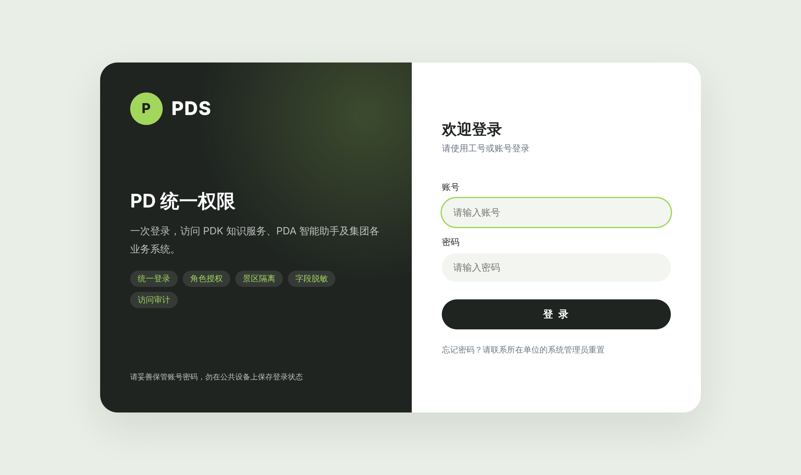
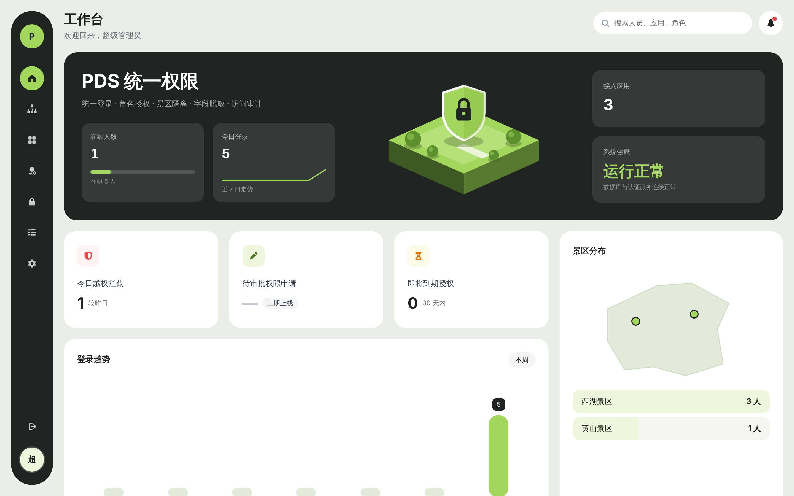
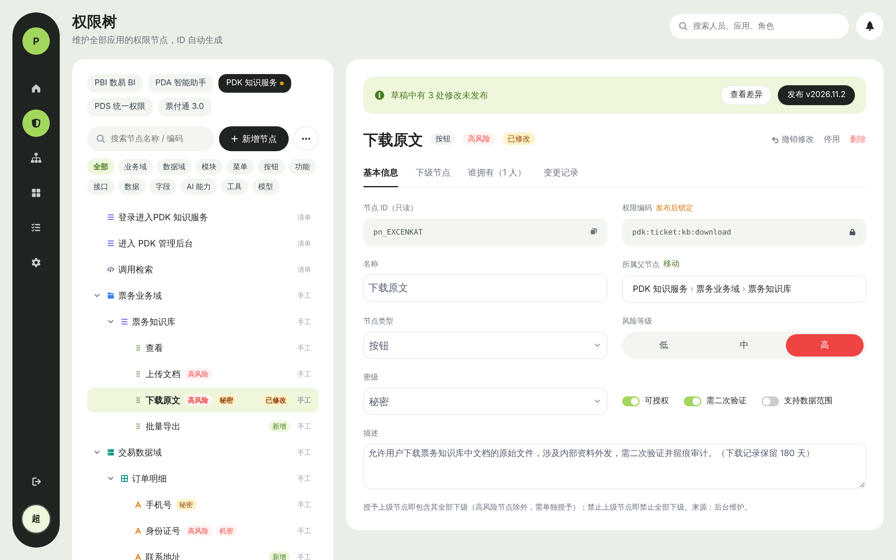
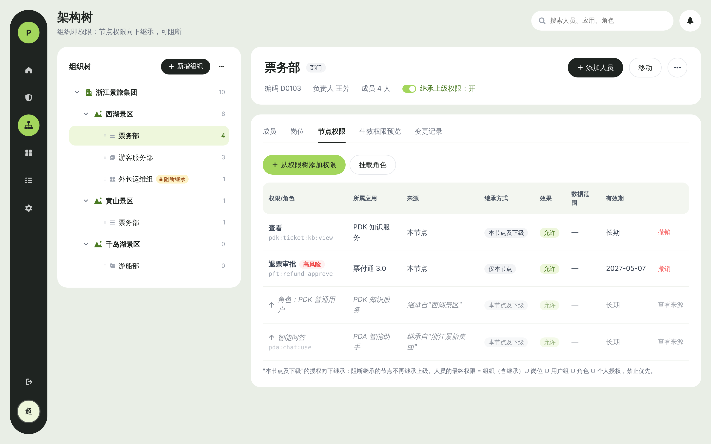
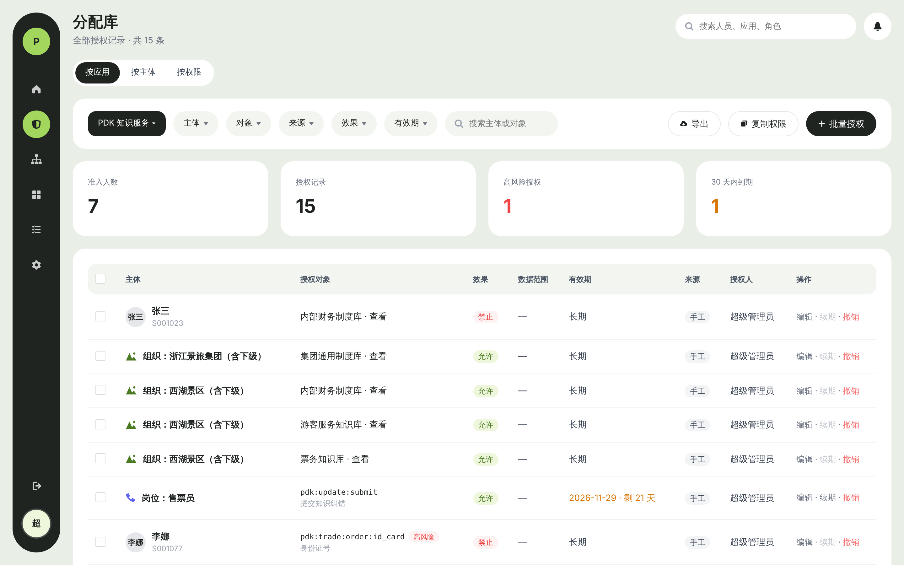
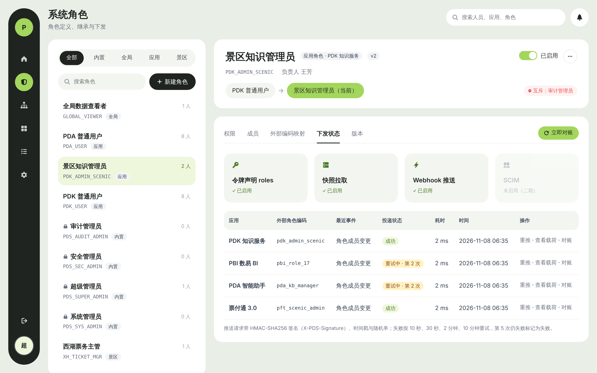
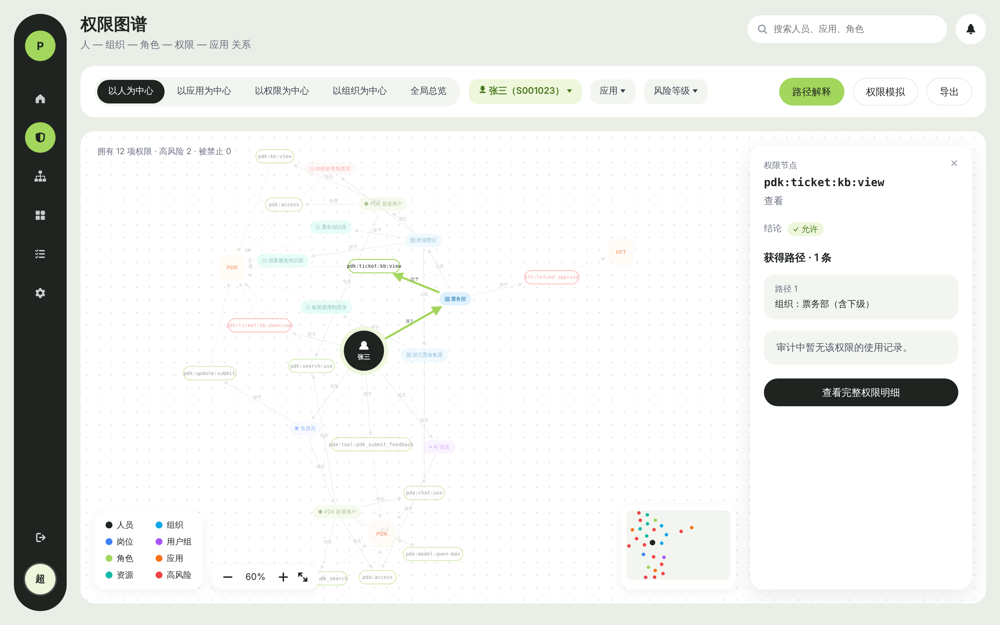
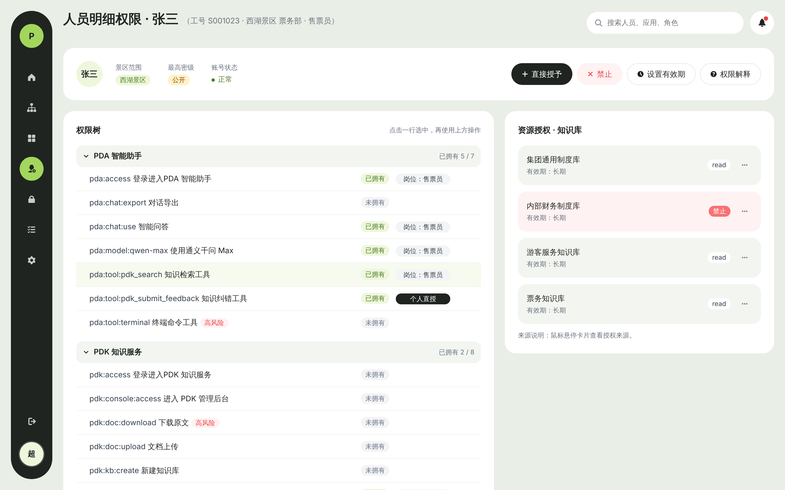

# pd_centralized_permission

**PDS 统一权限**：统一登录 · 组织架构 · 角色授权 · 人员明细权限 · 景区隔离 · 字段脱敏 · 访问审计（Java）

PDS 面向客户总体架构中的**全部系统**通用：应用层（票付通、景数通、数字大脑、畅游、各类 APP）、PDQ / PBI / PAP（PDA）、PDT / PDK / PDD、PDG、PDE、PDP / PDL / PDR、PDC、PBS。各系统按《[应用接入指南](docs/03-应用接入指南.md)》以同一方式接入。

| 统一登录 | 管理后台 · 工作台 |
|---|---|
|  |  |

**V2 权限中心**（按 UX Pilot 设计稿实现）

| 权限树 | 架构树 · 节点权限 |
|---|---|
|  |  |
| **分配库** | **系统角色 · 下发状态** |
|  |  |
| **权限图谱** | **人员明细权限** |
|  |  |

## 文档

| 文档 | 说明 |
|---|---|
| [00-总体架构与PDA接入方案](docs/00-总体架构与PDA接入方案.md) | PDK / PDS / PDA 总体架构、与客户架构的对应关系、身份透传、权限点目录、品牌规范 |
| [01-PDS产品功能文档](docs/01-PDS产品功能文档.md) | 功能清单、授权模型、对各系统的控制方案、接口清单、验收要点 |
| [02-PDS技术方案](docs/02-PDS技术方案.md) | 认证中心、授权引擎、景区隔离、脱敏、审计、事件、SDK、一期实现说明 |
| [03-应用接入指南](docs/03-应用接入指南.md) | 任一系统接入 PDS 的步骤、权限清单、客户端类型、令牌交换、鉴权集成 |
| [04-PDS功能扩展规划](docs/04-PDS功能扩展规划.md) | V2 规划：权限树、架构树、分配库、系统角色、权限图谱及补充模块，数据模型、接口、分期，借鉴 Sa-Token |

## 工程结构

```
pd_centralized_permission/
├── pds-common/          # 统一响应、错误码、业务异常、ID 生成
├── pds-authz-engine/    # 有效权限计算引擎（纯 Java，无框架依赖）+ 单元测试
├── pds-server/          # Spring Boot 服务：OIDC 认证中心 + 管理 API + 鉴权开放 API + 审计
│   └── src/main/resources/db/migration   # Flyway 表结构
├── pds-web/             # 管理后台前端（Vue 3 + View UI Plus），可单独部署或随 PDS 发布，见 pds-web/README.md
└── docs/
```

技术栈：Java 21、Spring Boot 4.1、Spring Security 7.1（内置 OAuth2 授权服务器）、MyBatis-Plus 3.5、Flyway、PostgreSQL 16（测试用 H2 PostgreSQL 兼容模式）、Caffeine、Thymeleaf。

## 快速开始

### 本地体验（内存数据库，无需安装 PostgreSQL）

```bash
mvn -DskipTests package
```

```bash
java -jar pds-server/target/pds-server-0.1.0-SNAPSHOT.jar --spring.profiles.active=local
```

- 统一登录页：<http://127.0.0.1:9000/login>，管理后台（需 `-Pweb` 打包）：<http://127.0.0.1:9000/console/>，初始账号 `admin`，密码 `Pds@Admin2026`（仅 `local` 配置）
- OIDC 发现文档：<http://127.0.0.1:9000/.well-known/openid-configuration>
- `local` 配置预置了 `pdk-console`、`pda-gateway`、`pda-plugin`、`pdk-service` 四个开发用客户端，见 `pds-server/src/main/resources/application-local.yml`

### 使用 PostgreSQL

```bash
PDS_DB_URL=jdbc:postgresql://localhost:5432/pds PDS_DB_USERNAME=pds PDS_DB_PASSWORD=*** \
PDS_ISSUER=https://pds.example.com PDS_JWT_KEYSTORE=file:/etc/pds/jwt.p12 PDS_JWT_KEYSTORE_PASSWORD=*** \
java -jar pds-server/target/pds-server-0.1.0-SNAPSHOT.jar
```

首次启动自动建表并创建初始超级管理员 `admin`；未设置 `PDS_ADMIN_PASSWORD` 时随机生成密码并在日志中输出一次，首次登录须修改。初始化完成后请分别创建系统管理员、安全管理员、审计管理员（三员分立），并停用超级管理员。

生成 JWT 签名密钥（生产必须配置，否则每次重启已签发令牌失效）：

```bash
keytool -genkeypair -alias pds -keyalg RSA -keysize 2048 -validity 3650 -storetype PKCS12 -keystore jwt.p12 -dname "CN=PDS"
```

### 管理后台（pds-web）

前端是独立工程，两种部署方式，环境差异通过运行时 `config.js` 配置（详见 [pds-web/README.md](pds-web/README.md)）：

- **随 PDS 一起发布**：`mvn -Pweb package`，访问 `{PDS}/console/`，`config.js` 由 PDS 按 `pds.console.*` 自动生成。
- **单独部署**：`docker build -t pds-web pds-web`，按 `PDS_ISSUER`、`PDS_UPSTREAM` 等环境变量运行；PDS 侧配置 `pds.console.redirect-uris`（以及不经反向代理时的 `pds.cors.allowed-origins`）。

本地开发：PDS 用 `local` 配置启动后，在 `pds-web` 下 `pnpm install && pnpm dev`，访问 <http://127.0.0.1:5173/>。

### 运行测试

```bash
mvn test
```

- `pds-authz-engine`：17 个引擎单元测试（禁止优先、组织继承、有效期、数据范围并集、资源动作层级、景区约束、密级、停用权限点、按应用过滤、结构化授权来源；V2：授予父节点含非高风险下级、禁止父节点含全部下级、上级路径可见、组织节点授权与草稿节点不生效）
- `pds-server`：13 个端到端集成测试（授权码 + PKCE 单点登录、管理后台公共客户端、首次登录强制改密、登录锁定、令牌交换、应用准入、权限清单、资源授权、人员明细禁止、鉴权开放接口、三员分立、停用即吊销、审计哈希链、工作台统计、批量导入、个人授权有效期、单条审计校验；V2：节点类型维护、权限树草稿/发布/编码锁定、组织节点授权与阻断继承、影响分析、分配库、应用角色继承/互斥/外部编码/Webhook 下发、快照 roles、权限图谱与路径解释、加人预览）

指定 PostgreSQL 运行集成测试：

```bash
mvn -pl pds-server test -Dspring.datasource.url=jdbc:postgresql://localhost:5432/pds -Dspring.datasource.username=pds -Dspring.datasource.password=***
```

## 接口一览

| 分类 | 接口 |
|---|---|
| OIDC | `/.well-known/openid-configuration`、`/oauth2/authorize`、`/oauth2/token`（授权码/刷新/客户端凭证/令牌交换）、`/oauth2/jwks`、`/userinfo`、`/connect/logout`、`/oauth2/revoke` |
| 组织架构 | `GET /api/v1/orgs/tree`、`POST/PUT/DELETE /api/v1/orgs`、`GET/POST /api/v1/positions` |
| 人员 | `GET/POST /api/v1/users`、`PUT /api/v1/users/{id}`、`PUT /api/v1/users/{id}/orgs`、`POST /api/v1/users/{id}/disable|leave|enable|reset-password`、`POST /api/v1/users/import`（批量导入，≤1000 行，逐行返回结果） |
| 用户组 | `GET/POST /api/v1/groups`、`PUT /api/v1/groups/{id}/members` |
| 应用 | `GET /api/v1/apps`、`PUT/DELETE /api/v1/apps/{app}`、`GET /api/v1/apps/{app}/delete-impact`、`POST /api/v1/apps/{app}/manifest`、`GET /api/v1/apps/{app}/permissions`、`POST /api/v1/apps/{app}/clients` |
| 资源 | `POST /api/v1/resources`、`DELETE /api/v1/resources/{type}/{refId}`、`GET/POST/DELETE /api/v1/resources/{type}/{refId}/grants` |
| 角色 | `GET/POST /api/v1/roles`、`PUT /api/v1/roles/{id}/permissions`、`GET/POST /api/v1/roles/{id}/bindings`、`DELETE /api/v1/role-bindings/{id}` |
| 人员明细权限 | `GET /api/v1/users/{id}/effective?app=`、`GET/POST/DELETE /api/v1/users/{id}/perms`、`PUT /api/v1/users/{id}/perms/{permId}`（修改有效期）、`PUT /api/v1/users/{id}/scenic-scope`、`PUT /api/v1/security-levels` |
| 管理后台 | `GET /api/v1/dashboard/overview`、`GET /api/v1/resources`、`GET /api/v1/resource-types`、`GET /api/v1/apps/{app}/clients`、`GET /api/v1/role-bindings`、`GET /api/v1/groups/{id}/members`、`GET /console/config.js` |
| 鉴权开放 | `POST /api/v1/authz/check`、`POST /api/v1/authz/batch-check`、`GET /api/v1/authz/snapshot`、`GET /api/v1/authz/explain`、`GET /api/v1/authz/resources/accessible` |
| 权限树（V2） | `GET /api/v1/perm-tree/apps`、`GET /api/v1/perm-tree?app=`、`GET /api/v1/perm-tree/grantable`、`GET/POST/PUT/DELETE /api/v1/perm-nodes`、`POST /api/v1/perm-nodes/{id}/disable|enable|discard`、`GET /api/v1/perm-nodes/{id}/holders|history`、`GET /api/v1/perm-tree/{app}/diff|versions|next-version`、`POST /api/v1/perm-tree/{app}/publish`、`GET/POST/PUT/DELETE /api/v1/perm-node-types`、`POST /api/v1/apps` |
| 分配库（V2） | `GET /api/v1/assignments`（按应用/主体/权限及多条件筛选）、`GET /api/v1/assignments/stats`、`POST /api/v1/assignments/impact`、`POST /api/v1/assignments/batch`、`PUT /api/v1/assignments/{id}`、`POST /api/v1/assignments/renew|revoke|copy` |
| 架构树（V2） | `GET /api/v1/orgs/{id}/info|grants|effective-preview|positions|history`、`POST /api/v1/orgs/{id}/grants`、`PUT /api/v1/orgs/{id}/inherit`、`POST /api/v1/orgs/{id}/members/preview`、`POST /api/v1/orgs/{id}/members`、`PUT /api/v1/orgs/{id}/members/{userId}/inherit` |
| 系统角色（V2） | `PUT/DELETE /api/v1/roles/{id}`、`POST /api/v1/roles/{id}/copy`、`PUT /api/v1/roles/{id}/mutex`、`GET/PUT /api/v1/roles/{id}/mappings`、`GET /api/v1/roles/{id}/versions|members|distribution`、`POST /api/v1/roles/{id}/versions/{vid}/restore`、`POST /api/v1/roles/{id}/reconcile` |
| 下发（V2） | `GET /api/v1/dist/subscriptions`、`GET/PUT /api/v1/dist/subscriptions/{app}`、`GET /api/v1/dist/deliveries`、`GET /api/v1/dist/deliveries/{id}/payload`、`POST /api/v1/dist/deliveries/{id}/retry` |
| 权限图谱（V2） | `GET /api/v1/graph/user/{userId}|app/{app}|org/{orgId}|overview`、`GET /api/v1/graph/perm?code=`、`GET /api/v1/graph/explain`、`POST /api/v1/graph/simulate` |
| 审计 | `GET /api/v1/audit/events`（可按人员、事件类型、应用、结果、景区、时间筛选）、`GET /api/v1/audit/verify`（全链校验）、`GET /api/v1/audit/events/{id}/verify`（单条校验）、`POST /api/v1/audit/events`（应用上报） |
| 个人中心 | `GET /api/v1/me`、`POST /api/v1/me/password` |

统一响应：`{"code":0,"message":"成功","data":{...}}`；错误码见 `pds-common` 的 `ErrorCode`，提示信息均为中文。

## 品牌

- 品牌标志：主色 `#1E50E6`（PDS 蓝），强调色 `#22E59A`（绿）。`pds-server/src/main/resources/static/assets/pds-logo.svg` 为按品牌稿绘制的矢量近似版，拿到设计源文件后直接替换同名文件即可。
- 界面配色：管理后台与统一登录页严格按 UX Pilot 设计稿，深炭 `#1F2421` + 黄绿 `#A3D65C`，页面底色 `#E9EEE6`，警示红 `#EF4444`。

相关仓库：[pd_knowledge_service](https://github.com/keanying/pd_knowledge_service)（PDK 知识服务）
