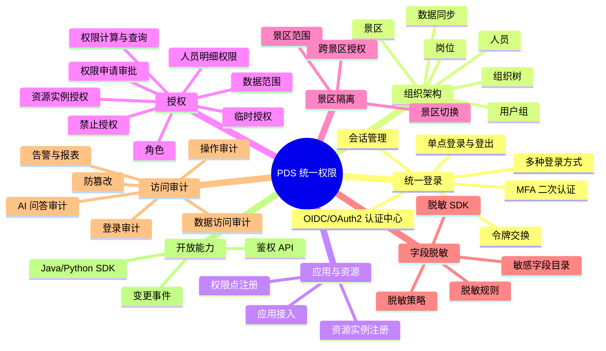
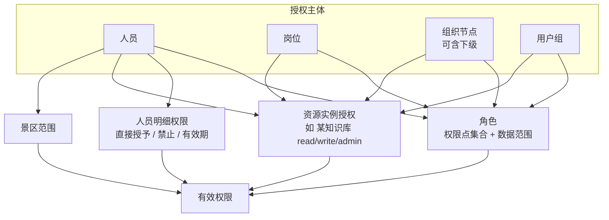

# PDS 统一权限 — 产品功能文档

> 产品名称：PDS 统一权限（PD Centralized Permission Service）
> 能力范围：统一登录 · 组织架构 · 角色授权 · 人员明细权限 · 景区隔离 · 字段脱敏 · 访问审计
> 技术栈：Java 21、Spring Boot 3、Spring Authorization Server（OIDC/OAuth2）、Spring Security、MyBatis-Plus、MySQL 8 / PostgreSQL、Redis、RocketMQ/Kafka、ClickHouse 或 Elasticsearch（审计）、Vue3 + Element Plus（管理后台）
> 文档版本：V0.1 草案
> 关联文档：[总体架构与 PDA 接入方案](./00-总体架构与PDA接入方案.md)、PDK 产品功能文档（`keanying/pd_knowledge_service/docs/01-PDK产品功能文档.md`）

---

## 1. 产品定位

PDS 是集团所有系统的**统一身份与权限中心**：

- 人只在 PDS 登录一次，即可进入 PDK 管理后台、PDA 智能助手及后续接入的业务系统（单点登录）；
- 组织架构（集团—景区—部门—岗位—人员）在 PDS 统一维护，是所有授权的基础；
- 按**组织架构 + 人员明细权限**模式，对 PDK 的全部能力（知识库、文档、检索、更新……）和 PDA（hermes-agent）的全部能力（问答、工具、技能、模型、记忆、定时任务……）进行权限控制；
- 提供景区隔离、字段脱敏、访问审计等安全能力，满足等保 2.0 三级要求。

在客户总体架构中，PDS 横跨"查数层"与"应用层"：一期接入 PDK 与 PAP 智能体平台（即 PDA，hermes 内核）；后续接入 PDQ 即席自助、PBI 数易 BI、PDT 标签中心、PDD 数据服务，以及票付通 3.0、景数通、数字大脑、畅游等应用。因此所有能力按**多应用通用**设计，不为某一个应用定制。PDS 的网关、配置、消息、监控、通知等基础设施使用客户 **PBS 公共底座**。

PDS **不负责**具体业务数据的存储，只负责"谁是谁、谁能做什么、能看哪些数据、看到的数据要不要脱敏、做了什么要留痕"。

## 2. 用户角色（三员分立）

| 角色 | 职责 | 不能做 |
|---|---|---|
| 系统管理员 | 组织架构、人员账号、应用接入、权限点注册、系统参数 | 不能给自己授权、不能查看审计日志 |
| 安全管理员 | 角色定义、授权、人员明细权限、景区范围、脱敏策略、密码与登录安全策略 | 不能管理账号、不能修改审计 |
| 审计管理员 | 查看与导出审计日志、配置审计告警、审查前两类管理员的操作 | 不能做任何授权与账号管理 |
| 景区管理员（分级） | 在被授予的景区范围内，管理本景区人员与授权（权限不能超过自身） | 不能操作其他景区 |
| 普通人员 | 登录、修改个人信息与密码、查看本人权限、申请权限 | — |
| 接入应用 | PDK、PDA、业务系统，通过 OIDC 登录，通过 API 鉴权、获取脱敏策略、上报审计 | — |

> 超级管理员仅用于初始化，初始化完成后建议禁用。

## 3. 功能总览



优先级：**P0** = 一期必须；**P1** = 二期；**P2** = 规划。

## 4. 功能详述

### 4.1 统一登录（认证中心）

| 编号 | 功能 | 描述 | 优先级 |
|---|---|---|---|
| SSO-01 | OIDC/OAuth2 认证中心 | 支持授权码 + PKCE（Web/H5）、客户端凭证（系统间）、刷新令牌；提供 `/.well-known/openid-configuration`、JWKS 公钥 | P0 |
| SSO-02 | 统一登录页 | 中文登录页，可按应用/景区展示 Logo 与名称；支持账号密码、手机短信验证码 | P0 |
| SSO-03 | 扫码登录 | 对接企业微信 / 钉钉 / 飞书扫码登录（按客户现有 IM 选择） | P1 |
| SSO-04 | 第三方身份源 | 对接 LDAP/AD 认证 | P1 |
| SSO-05 | MFA 二次认证 | 短信 / TOTP 动态口令；可按角色强制（管理员必须开启）、按风险触发（异地、新设备） | P0 |
| SSO-06 | 单点登录 | 登录一次访问所有接入应用；应用间跳转免登 | P0 |
| SSO-07 | 单点登出 | 任一应用退出，通知所有应用（OIDC 前/后端通道登出）并吊销令牌 | P0 |
| SSO-08 | 会话管理 | 查看在线会话（设备、IP、应用、登录时间），可强制下线；账号禁用/离职时立即吊销全部会话与令牌 | P0 |
| SSO-09 | 令牌交换 | 支持 RFC 8693 令牌交换：PDA 以"用户令牌"换取访问 PDK 的短时票据（audience=pdk，有效期 ≤5 分钟），用于智能体代表用户调用知识服务 | P0 |
| SSO-10 | 密码策略 | 长度与复杂度、有效期、历史密码不可重复、首次登录强制修改、连续失败锁定 | P0 |
| SSO-11 | 登录安全 | 图形/滑块验证码、IP 黑白名单、登录时段限制、异常登录提醒 | P1 |
| SSO-12 | 个人中心 | 修改密码、绑定手机、MFA 管理、查看本人权限、查看本人登录记录 | P0 |

### 4.2 组织架构

| 编号 | 功能 | 描述 | 优先级 |
|---|---|---|---|
| ORG-01 | 组织树 | 多级组织树：集团 → 公司/景区 → 部门 → 班组；节点类型可配置；支持拖拽调整、合并、撤销（撤销前需迁移人员） | P0 |
| ORG-02 | 景区 | 景区作为一等组织节点，带景区编码、等级、地址、负责人；景区是数据隔离的基本单位 | P0 |
| ORG-03 | 岗位 | 岗位库（如售票员、讲解员、安保、运营主管）；岗位可绑定默认角色，人员任职该岗位自动获得 | P0 |
| ORG-04 | 人员 | 工号、姓名、手机、邮箱、所属组织（**一人可多部门/多岗位**，指定主部门）、人员类型（正式/外包/实习/临时）、状态（在职/停用/离职）、入职与离职日期 | P0 |
| ORG-05 | 用户组 | 跨组织的人员集合（如"应急小组""知识管理员"），可整体授权 | P0 |
| ORG-06 | 人员变动 | 调岗、兼岗、离职：调岗时自动重算权限，离职时自动禁用账号、吊销会话、移交其名下资源（通知各应用） | P0 |
| ORG-07 | 数据同步 | 从 HR 系统 / 企业微信 / 钉钉 / LDAP 定时或实时同步组织与人员；同步冲突提示人工处理；同步日志 | P1 |
| ORG-08 | 批量导入导出 | Excel 模板导入组织与人员，校验错误中文提示 | P0 |
| ORG-09 | 分级管理 | 为景区管理员分配可管理的组织范围，其只能在该范围内维护人员与授权 | P0 |

### 4.3 应用与资源注册

| 编号 | 功能 | 描述 | 优先级 |
|---|---|---|---|
| APP-01 | 应用接入 | 登记应用（PDK、PDA、业务系统）：应用编码、名称、回调地址、登出地址、客户端密钥、授权方式、可访问的景区范围 | P0 |
| APP-02 | 权限点注册 | 应用以"权限清单"（JSON/YAML）注册菜单、按钮、接口、AI 能力等权限点，支持版本化；也可在后台手工维护；清单示例见 §6 | P0 |
| APP-03 | 资源实例注册 | 应用把可授权的数据实例注册到 PDS（如 PDK 的每个知识库 `pdk:kb:{id}`、PDA 的每个工具/技能/模型），带所属景区与负责人 | P0 |
| APP-04 | 动态能力同步 | PDA 新增工具/技能/模型时自动注册对应权限点（`pda:tool:*`、`pda:skill:*`、`pda:model:*`），新权限点**默认无人拥有** | P0 |
| APP-05 | 应用访问控制 | 控制哪些组织/人员可以登录某个应用（应用级准入） | P0 |

### 4.4 授权（核心）

#### 4.4.1 授权模型

PDS 采用 **RBAC + 人员明细权限 + 数据范围 + 资源实例授权** 的组合模型：



**有效权限计算规则：**

1. **来源合并**：人员有效权限 = 本人直授角色 ∪ 所任岗位的角色 ∪ 所在组织节点（及开启继承的上级节点）的角色 ∪ 所在用户组的角色 ∪ 人员明细直接授予的权限点；
2. **禁止优先**：任何来源上的"禁止"（尤其是人员明细中的禁止）优先于授予；
3. **景区约束**：所有权限只在该人员的景区范围内生效；跨景区必须显式授权；
4. **有效期**：临时授权到期自动失效；
5. **数据范围取并集**：同一权限点的多个数据范围取并集（禁止项除外）；
6. **授权不越级**：分级管理员只能授予自己拥有的权限，且范围不能超过自身。

#### 4.4.2 功能清单

| 编号 | 功能 | 描述 | 优先级 |
|---|---|---|---|
| AUZ-01 | 角色管理 | 新建角色（集团级/景区级），勾选权限点（按应用分组的树形勾选），设置每个数据类权限的数据范围（SELF/DEPT/DEPT_TREE/SCENIC/SCENIC_LIST/ALL/CUSTOM） | P0 |
| AUZ-02 | 角色模板 | 预置模板：PDK 知识管理员、知识贡献者、知识审核员、PDA 普通用户、PDA 高级用户、审计员等；景区复制模板后微调 | P0 |
| AUZ-03 | 角色分配 | 将角色分配给人员、岗位、组织节点（可选"含下级"）、用户组 | P0 |
| AUZ-04 | **人员明细权限** | 以"人"为中心的权限页：展示此人从各来源获得的全部权限（标明来源：岗位/部门/用户组/直授），并可对单个权限点或资源实例进行**直接授予、禁止、设置有效期**，用于例外处理 | P0 |
| AUZ-05 | 资源实例授权 | 以"资源"为中心授权：如选中某知识库，授权给某部门 read、某人 admin、禁止某人；PDK 后台的"知识库授权"页签调用此能力 | P0 |
| AUZ-06 | PDA 能力授权 | 以"能力"为中心的矩阵视图：行=组织/人员，列=PDA 工具/技能/模型/记忆/定时任务等，勾选即授权 | P0 |
| AUZ-07 | 密级授权 | 为人员/岗位设置可访问的最高知识密级 | P0 |
| AUZ-08 | 临时授权 | 授权带开始/结束时间，到期自动回收，到期前提醒 | P1 |
| AUZ-09 | 权限申请审批 | 人员在个人中心或应用内（如 PDA 提示"无权限，去申请"）发起申请 → 直属上级/资源负责人审批 → 自动授权；支持多级审批 | P1 |
| AUZ-10 | 权限查询与解释 | 输入"人 + 权限点/资源"，回答"有/无"并解释原因（来自哪个角色/岗位，或被哪条禁止规则拦截） | P0 |
| AUZ-11 | 权限对比 | 对比两个人员/角色的权限差异，便于调岗、复制权限 | P1 |
| AUZ-12 | 授权复核 | 定期（如每季度）生成授权复核任务，由部门负责人确认下属权限是否仍需要；长期未使用的权限提示回收 | P2 |
| AUZ-13 | 职责冲突 | 配置互斥角色（如"知识上传"与"知识审核"不可同一人在同一知识库），授权时检查 | P2 |

### 4.5 景区隔离

| 编号 | 功能 | 描述 | 优先级 |
|---|---|---|---|
| SCN-01 | 景区范围 | 每个人员有"景区范围"：默认为所属景区；集团人员可配置多个景区或全部 | P0 |
| SCN-02 | 令牌携带景区 | 访问令牌中包含当前景区与可访问景区列表（或其摘要/版本号），应用据此过滤数据 | P0 |
| SCN-03 | 景区切换 | 拥有多景区权限的人员在应用顶部切换"当前景区"，切换操作入审计 | P0 |
| SCN-04 | 隔离规则 | 景区管理员只能管理本景区人员与授权；景区角色只能分配给本景区人员；景区级资源不能授权给其他景区人员（除非集团安全管理员开启跨景区共享） | P0 |
| SCN-05 | 隔离 SDK | Java/Python SDK 提供"当前用户可访问景区"查询与 SQL/Milvus 过滤条件生成工具，便于各应用统一实现 | P0 |

### 4.6 字段脱敏

| 编号 | 功能 | 描述 | 优先级 |
|---|---|---|---|
| MSK-01 | 敏感数据分类分级 | 预置敏感类型：手机号、身份证号、银行卡号、姓名、地址、邮箱、车牌、护照号、金额等；可自定义（正则 + 关键字） | P0 |
| MSK-02 | 脱敏规则 | 掩码（138****1234）、部分保留、哈希、截断、替换为固定值、完全隐藏 | P0 |
| MSK-03 | 敏感字段目录 | 应用注册其数据字段与敏感类型（如 PDK 文档的"负责人电话"、切片中的 PII 识别结果） | P0 |
| MSK-04 | 脱敏策略 | 按"应用 + 字段/敏感类型 + 授权主体（角色/岗位/人员）"配置展示方式：明文/脱敏/隐藏；默认脱敏，明文需显式授权 | P0 |
| MSK-05 | 策略下发 | 应用通过 API 获取当前用户的脱敏策略（随权限快照下发，可缓存）；SDK 提供注解/工具方法一键脱敏 | P0 |
| MSK-06 | AI 输出脱敏 | 为 PDA 提供文本脱敏接口：对智能体输出、工具结果中识别到的敏感信息按策略处理（PDA 插件在工具返回后和回答输出前调用） | P0 |
| MSK-07 | 明文查看留痕 | 用户点击"查看明文"需有权限，且每次查看记录审计 | P1 |
| MSK-08 | 脱敏效果预览 | 管理员可选择"某人 + 某应用"预览脱敏效果 | P1 |

### 4.7 访问审计

| 编号 | 功能 | 描述 | 优先级 |
|---|---|---|---|
| AUD-01 | 登录审计 | 登录/登出/失败/锁定/MFA/令牌交换，记录时间、账号、IP、设备、应用、结果 | P0 |
| AUD-02 | 管理操作审计 | PDS 内所有组织、账号、角色、授权、策略变更，记录变更前后值 | P0 |
| AUD-03 | 应用操作审计 | 接入应用上报的操作事件（PDK 的上传/编辑/删除/下载/授权等） | P0 |
| AUD-04 | 数据访问审计 | 谁在何时访问了哪些数据（PDK 检索命中了哪些知识库/文档/切片、下载了哪些原文） | P0 |
| AUD-05 | AI 问答审计 | PDA 每轮对话：用户、会话、问题、调用的工具及参数摘要、命中的文档、是否被权限拦截、回答摘要、使用模型、耗时；原文问答可按策略加密存储，仅审计管理员可查看 | P0 |
| AUD-06 | 权限拦截记录 | 所有"无权限"拒绝事件集中记录，便于发现越权尝试与权限配置缺失 | P0 |
| AUD-07 | 查询与导出 | 按人员、组织、景区、应用、事件类型、时间、结果多条件查询；导出 Excel（导出操作本身也审计） | P0 |
| AUD-08 | 防篡改 | 审计日志只追加；按批次计算哈希链，提供完整性校验；审计管理员也不能删除 | P1 |
| AUD-09 | 留存 | 在线保留 ≥ 6 个月，归档保留 ≥ 3 年（可配置） | P0 |
| AUD-10 | 告警 | 规则告警：非工作时间大量下载、短时间大量检索敏感库、频繁越权、管理员异常操作；通过短信/邮件/IM 通知 | P1 |
| AUD-11 | 报表 | 登录统计、权限分布、敏感数据访问统计、AI 使用统计，按景区出报表 | P1 |

### 4.8 开放能力（供 PDK、PDA 及其他应用接入）

| 编号 | 功能 | 描述 | 优先级 |
|---|---|---|---|
| OPN-01 | 鉴权 API | 单个与批量权限判断（详见 §7） | P0 |
| OPN-02 | 权限快照 API | 一次返回某用户在某应用的全部权限点、数据范围、景区范围、可访问资源实例、最高密级、脱敏策略及快照版本号，供应用缓存 | P0 |
| OPN-03 | 变更事件 | 授权、人员、组织、脱敏策略变化时发布事件（MQ 或 Webhook）：`authz.changed`、`user.disabled`、`org.changed`、`mask.changed`，应用据此清缓存 | P0 |
| OPN-04 | 审计上报 API | 应用批量上报审计事件（异步、可靠投递，失败本地暂存重传） | P0 |
| OPN-05 | Java SDK | Spring Boot Starter：OIDC 登录集成、`@RequirePermission` 注解、数据范围拦截、`@Mask` 脱敏注解、审计上报 | P0 |
| OPN-06 | Python SDK | 供 PDK 与 PDA 插件使用：令牌校验、权限快照缓存、Milvus/SQL 过滤条件生成、脱敏、审计上报、令牌交换 | P0 |
| OPN-07 | 组织与人员查询 API | 供应用查询组织树、人员、岗位（选择授权对象时使用） | P0 |

### 4.9 工作台（管理后台首页）

界面后续用 UX Pilot 设计（参考客户提供的浅绿色仪表盘模板：左侧图标导航、顶部主视觉 + 核心指标、下方指标卡片与图表）。按登录人角色展示不同内容：

| 编号 | 内容 | 面向 | 优先级 |
|---|---|---|---|
| DSH-01 | 核心指标：在线人数、今日登录人次、接入应用数、今日越权拦截次数 | 全部管理员 | P0 |
| DSH-02 | 登录趋势图（按天/周，按景区筛选） | 系统/安全管理员 | P0 |
| DSH-03 | 待办：待审批权限申请、即将到期的临时授权、同步冲突 | 安全/系统管理员 | P1 |
| DSH-04 | 安全态势：异常登录、MFA 覆盖率、弱密码账号数、长期未登录账号数 | 安全管理员 | P1 |
| DSH-05 | 应用健康：各接入应用鉴权调用量、错误率、权限快照缓存命中率 | 系统管理员 | P1 |
| DSH-06 | AI 使用概况：PDA 问答量、知识检索量、敏感数据访问量（按景区） | 审计管理员 | P1 |
| DSH-07 | 景区分布：各景区人员数、角色数、授权数 | 系统管理员 | P1 |
| DSH-08 | 审计告警：最新告警列表 | 审计管理员 | P1 |

### 4.10 后续应用接入预留

| 编号 | 场景 | PDS 需提供的能力 | 优先级 |
|---|---|---|---|
| EXT-01 | PDD 数据服务 / PDT 标签中心 | 数据集、数据 API、指标、标签作为资源实例授权；**列级脱敏**（字段目录 + 脱敏策略）；行级数据范围（按景区/组织） | P1 |
| EXT-02 | PDQ 即席自助 / 智能问数 | 生成 SQL 前下发"可见表/列/行过滤条件"；结果集脱敏 | P2 |
| EXT-03 | PBI 数易 BI | 看板、大屏、驾驶舱作为资源授权；嵌入式单点登录 | P2 |
| EXT-04 | 应用层（票付通、景数通等） | 标准 OIDC 接入 + SDK；应用准入 | P1 |

## 5. 对 PDK 与 PDA 的权限控制方案

### 5.1 控制矩阵

| 被控对象 | 控制点 | PDS 提供 | 应用侧执行 |
|---|---|---|---|
| PDK 管理后台 | 能否进入、能看到哪些菜单按钮 | `pdk:console:access` 及功能权限点 | 前端按权限渲染，后端接口注解校验 |
| PDK 知识库 | 能看/能改/能管哪些库 | 资源实例授权 `pdk:kb:{id}` + 景区范围 + 禁止规则 | 列表与操作过滤 |
| PDK 文档 | 能否下载原文、能否审核、密级 | `pdk:doc:*` + 最高密级 | 接口校验 + 检索过滤 |
| PDK 检索 | 检索时能命中哪些内容 | 权限快照（可读知识库、景区、密级） | 生成 Milvus 过滤表达式，**检索前过滤** |
| PDK 结果字段 | 敏感信息是否脱敏 | 脱敏策略 | 返回前脱敏 |
| PDA 使用 | 能否使用问答 | `pda:chat:use` | PDA 接入网关校验 |
| PDA 工具 | 能用哪些工具（含知识工具） | `pda:tool:{工具名}` | hermes 插件 `pre_tool_call` 钩子拦截（block / 需审批） |
| PDA 技能 | 能用哪些技能、能否管理技能 | `pda:skill:{技能名}`、`pda:skill:manage` | 插件按会话裁剪可用技能 |
| PDA 模型 | 能用哪些大模型 | `pda:model:{模型编码}` | 网关按权限选择/拒绝模型 |
| PDA 记忆/定时任务/子代理 | 是否启用 | `pda:memory:use`、`pda:cron:use`、`pda:subagent:use` | 插件拦截相关工具 |
| PDA 输出 | 回答中的敏感信息 | 文本脱敏接口 | 网关出站前处理 |
| 全部 | 行为留痕 | 审计上报 API | PDK、网关、插件上报 |

### 5.2 典型配置示例：景区 A 的售票员张三

| 来源 | 内容 |
|---|---|
| 岗位"售票员" → 角色"PDA 普通用户" | `pda:chat:use`、`pda:tool:pdk_search`、`pda:tool:pdk_get_context`、`pda:history:view`、`pda:model:默认模型` |
| 组织"景区 A" → 资源授权 | 景区 A 的"票务知识库""游客服务知识库" read |
| 集团共享 | 集团"通用制度库" read |
| 密级 | 最高"内部" |
| **人员明细** | 张三额外授予 `pda:tool:pdk_submit_feedback`（他是票务知识联络人）；**禁止** 景区 A"内部财务制度库" |
| 脱敏 | 切片中的手机号、身份证号对张三显示掩码 |

结果：张三登录 PDA 提问，只会检索到景区 A 票务/游客服务库和集团通用制度库中"内部"及以下密级内容，不会命中财务制度库；他可以提交纠错；回答中的手机号被掩码；所有问答在审计中心可查。

## 6. 权限清单注册格式（示例）

```yaml
app: pda
version: 2026.11.1
name: PD 智能助手
permissions:
  - code: pda:chat:use
    name: 使用智能问答
    type: function
  - code: pda:tool:pdk_search
    name: 知识检索工具
    type: ai_tool
    risk: low
  - code: pda:tool:terminal
    name: 终端命令工具
    type: ai_tool
    risk: high          # 高风险：授权需安全管理员 + 审批；默认无人拥有
  - code: pda:model:qwen-max
    name: 使用通义千问 Max
    type: ai_model
resourceTypes:
  - type: pda:skill
    actions: [use, manage]
```

完整的 PDK / PDA 权限点目录见《总体架构与 PDA 接入方案》§6。

## 7. 接口清单

### 7.1 认证（OIDC 标准）

| 路径 | 说明 |
|---|---|
| `GET /.well-known/openid-configuration` | 发现文档 |
| `GET /oauth2/authorize` | 授权端点（授权码 + PKCE） |
| `POST /oauth2/token` | 令牌端点（授权码、刷新、客户端凭证、令牌交换） |
| `GET /oauth2/jwks` | 公钥 |
| `GET /userinfo` | 用户信息（工号、姓名、主部门、景区） |
| `POST /oauth2/revoke` | 吊销令牌 |
| `GET /connect/logout` | 单点登出 |

访问令牌（JWT，RS256 或国密 SM2）主要声明：`sub`（人员 ID）、`name`、`emp_no`、`dept_id`、`scenic_id`（当前景区）、`scenic_scope`（可访问景区）、`authz_ver`（权限版本号）、`aud`、`exp`。

### 7.2 授权与开放 API（前缀 `/api/v1`）

| 方法与路径 | 说明 |
|---|---|
| `POST /authz/check` | 单个权限判断：`{subject, app, permission, resource?, context?}` → `{allowed, reason}` |
| `POST /authz/batch-check` | 批量判断（如一次判断 20 个工具） |
| `GET /authz/snapshot?app=pdk&subject=...` | 权限快照（权限点、数据范围、景区、资源实例、密级、脱敏策略、版本号） |
| `GET /authz/resources/accessible?type=pdk:kb&action=read` | 可访问的资源实例列表 |
| `GET /authz/explain` | 权限解释 |
| `POST /apps/{app}/manifest` | 注册/更新权限清单 |
| `POST /resources` / `DELETE /resources/{id}` | 注册/注销资源实例 |
| `GET/PUT /resources/{id}/grants` | 资源实例授权（PDK 知识库授权页使用） |
| `GET /mask/policies?app=...&subject=...` | 脱敏策略 |
| `POST /mask/text` | 文本脱敏（PDA 输出与工具结果使用） |
| `POST /audit/events` | 批量上报审计事件 |
| `GET /orgs/tree`、`GET /users`、`GET /positions`、`GET /groups` | 组织人员查询 |

### 7.3 变更事件

| 事件 | 触发 | 消费方动作 |
|---|---|---|
| `authz.changed` | 角色/授权/人员明细/资源授权变化（含受影响人员列表） | 清除权限快照缓存 |
| `user.disabled` | 账号停用/离职 | 立即终止会话，清缓存，PDA 结束该用户会话 |
| `org.changed` | 组织/岗位变化 | 刷新组织缓存 |
| `mask.changed` | 脱敏策略变化 | 清除脱敏策略缓存 |

## 8. 数据模型（核心表）

| 表 | 关键字段 |
|---|---|
| `org_unit` | id, parent_id, path, type(集团/公司/景区/部门/班组), code, name, scenic_id, leader_id, sort, status |
| `org_scenic` | id, org_unit_id, code, name, level, address |
| `org_position` | id, code, name, scenic_id |
| `sys_user` | id, emp_no, name, mobile(加密), email, user_type, status, primary_org_id, scenic_id, pwd_hash, mfa_secret(加密), last_login_at |
| `sys_user_org` | user_id, org_id, position_id, is_primary |
| `sys_group` / `sys_group_member` | 用户组及成员 |
| `app_client` | id, code, name, client_secret_hash, redirect_uris, logout_uri, grant_types, scenic_scope |
| `perm_point` | id, app, code, name, type(菜单/按钮/接口/数据/AI工具/AI模型/AI技能), risk, manifest_version |
| `perm_resource` | id, type, ref_id, app, scenic_id, owner_id, name |
| `auth_role` | id, code, name, level(集团/景区), scenic_id |
| `auth_role_perm` | role_id, perm_id, data_scope, scope_value(json) |
| `auth_role_binding` | role_id, subject_type(用户/岗位/组织/用户组), subject_id, include_children, valid_from, valid_to |
| `auth_user_perm` | **人员明细权限**：user_id, perm_id 或 resource_id, action, effect(允许/禁止), valid_from, valid_to, reason, granted_by |
| `auth_resource_grant` | resource_id, subject_type, subject_id, include_children, action, effect, valid_from, valid_to |
| `auth_user_scenic` | user_id, scenic_id（景区范围） |
| `auth_security_level` | subject_type, subject_id, max_level |
| `mask_sensitive_type` / `mask_rule` / `mask_policy` | 敏感类型、规则、策略 |
| `auth_apply` | 权限申请与审批流 |
| `audit_event`（ClickHouse/ES） | id, ts, app, event_type, user_id, scenic_id, ip, resource, action, result, detail(json), hash, prev_hash |

## 9. 管理后台菜单

```
PDS 统一权限
├── 工作台（待审批、即将到期授权、异常告警、在线人数）
├── 组织架构
│   ├── 组织与景区
│   ├── 岗位
│   ├── 人员
│   ├── 用户组
│   └── 数据同步
├── 应用管理
│   ├── 应用接入
│   ├── 权限点
│   └── 资源实例
├── 授权管理
│   ├── 角色
│   ├── 人员明细权限
│   ├── 资源授权（知识库等）
│   ├── PDA 能力授权矩阵
│   ├── 密级授权
│   ├── 权限申请审批
│   └── 权限查询与解释
├── 数据安全
│   ├── 敏感类型
│   ├── 脱敏规则
│   └── 脱敏策略
├── 安全策略（密码、登录、MFA、会话、IP）
├── 审计中心（仅审计管理员）
│   ├── 登录日志
│   ├── 管理操作日志
│   ├── 数据访问日志
│   ├── AI 问答审计
│   ├── 越权拦截记录
│   ├── 告警规则
│   └── 统计报表
└── 系统设置（参数、字典、通知渠道）
```

## 10. 非功能需求

| 类别 | 指标 |
|---|---|
| 性能 | 鉴权 API P99 ≤ 20ms（缓存命中）；权限快照 P95 ≤ 100ms；登录 P95 ≤ 500ms；支持 5000 在线用户、鉴权 2000 QPS |
| 生效时效 | 授权变更 60 秒内在 PDK/PDA 生效；账号停用立即生效 |
| 可用性 | 多实例部署，可用性 ≥ 99.95%；PDS 不可用时应用侧使用缓存快照只读降级，**不得默认放行** |
| 安全 | 密码 BCrypt/国密 SM3 加盐；敏感字段 AES/SM4 加密存储；全站 TLS；令牌短时有效（访问令牌 30 分钟，刷新令牌 8 小时，可配） |
| 合规 | 等保 2.0 三级：三员分立、审计留存 ≥ 6 个月、登录失败处理、会话超时、关键操作二次确认 |
| 审计可靠性 | 审计事件至少一次投递，不丢失；日志不可修改删除 |
| 本地化 | 全中文界面与提示；支持国密算法选项 |
| 可扩展 | 新应用按"注册应用 → 提交权限清单 → 集成 SDK"三步接入 |

## 11. 建议的代码结构

```
pd_centralized_permission/
├── docs/
├── pds-common/          # 公共模型、错误码、工具
├── pds-auth-server/     # OIDC 认证中心（Spring Authorization Server）
├── pds-admin/           # 组织、应用、授权、脱敏管理 API
├── pds-authz-engine/    # 权限计算引擎（有效权限、数据范围、快照、缓存）
├── pds-audit/           # 审计接收、存储、查询、告警
├── pds-sdk-java/        # Spring Boot Starter
├── pds-sdk-python/      # Python SDK（供 PDK、PDA 使用）
├── pds-web/             # 管理后台前端（Vue3 + Element Plus）
└── deploy/
```

## 12. 验收要点（一期）

1. 同一账号登录 PDS 后，访问 PDK 管理后台与 PDA 门户均免登；在任一处退出，另一处同时失效；
2. 组织树中新增景区 B 与人员，景区 B 管理员看不到景区 A 的人员和授权；
3. 通过岗位授予角色、对某人员明细"禁止"某知识库，权限解释能准确说明结果来源；
4. PDA 中新增一个工具后，PDS 自动出现对应权限点且默认无人拥有，未授权人员调用被拦截并记录越权日志；
5. 将某人停用后，其 PDA 正在进行的会话立即无法继续；
6. 审计中心可按人员查询其登录、问答、命中文档、下载记录，审计管理员无法删除日志。
