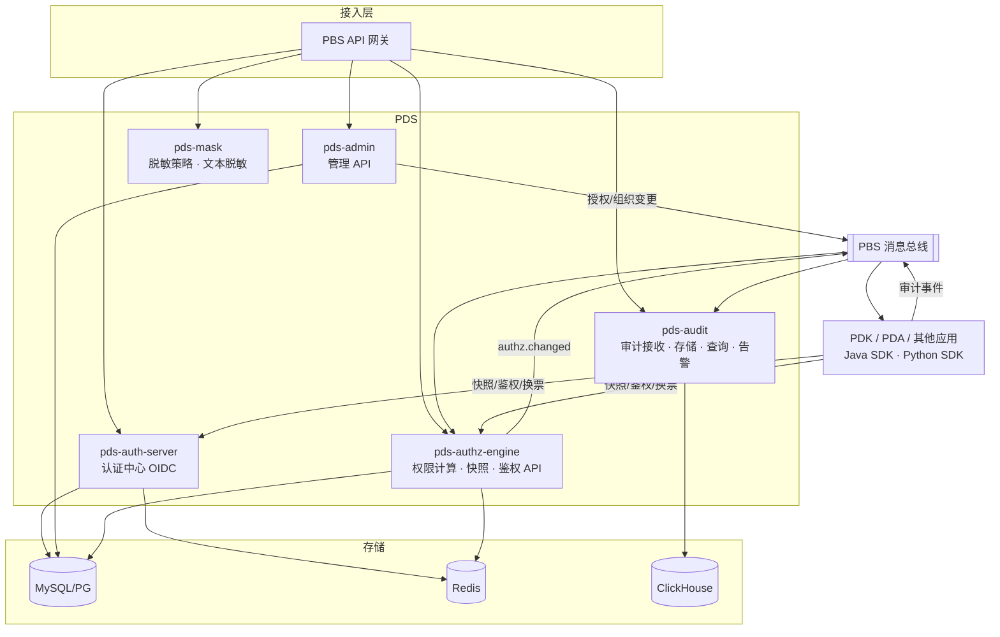
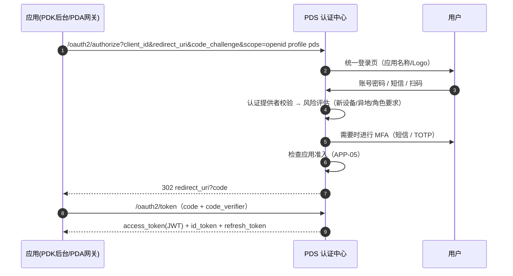
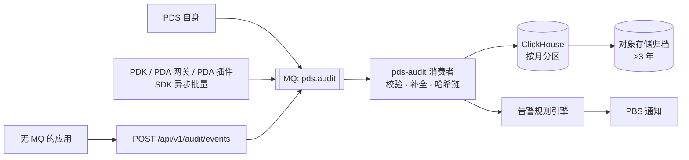

# PDS 统一权限 — 技术方案

> 文档版本：V0.1 草案
> 关联文档：[00-总体架构与 PDA 接入方案](./00-总体架构与PDA接入方案.md)、[01-PDS 产品功能文档](./01-PDS产品功能文档.md)、PDK 技术方案（`keanying/pd_knowledge_service/docs/02-PDK技术方案.md`）
> UI 暂不设计，后续使用 UX Pilot 按客户提供的仪表盘模板出稿。

---

## 1. 设计原则

1. **标准协议**：认证采用 OIDC / OAuth 2.1，令牌交换采用 RFC 8693，任何应用都能按标准接入。
2. **决策集中、执行分散**：PDS 计算"有效权限"，应用（PDK、PDA 等）在本地缓存快照并执行；高频鉴权不走远程调用。
3. **禁止优先、默认拒绝**：没有明确授予就是无权限；禁止规则优先于一切授予；PDS 不可用时不放行。
4. **变更可追溯**：所有授权变更带操作人、原因、前后值，进入不可篡改的审计。
5. **多应用通用**：权限点、资源、脱敏字段均由应用注册，PDS 不写死任何应用逻辑。
6. **复用 PBS**：网关、配置、消息、监控、通知使用客户 PBS 公共底座。

## 2. 技术选型

| 层次 | 选型 | 说明 |
|---|---|---|
| 语言与框架 | Java 21、Spring Boot 4.1 | 当前受支持的 Boot 主线；虚拟线程提升 IO 并发 |
| 认证中心 | Spring Security 7.1 内置 OAuth2 授权服务器（原 Spring Authorization Server 已并入） | OIDC Provider；支持令牌交换（RFC 8693） |
| 安全 | Spring Security 7.1 | 资源服务器、方法级鉴权 |
| 会话 | Spring Session + Redis | 认证中心登录会话集中存储，支持多实例与强制下线 |
| ORM | MyBatis-Plus 3.5（Boot 4 starter） | 一期景区隔离在服务层按数据范围过滤，二期加拦截器 |
| 数据库 | MySQL 8 或 PostgreSQL 15（信创可选达梦 / 人大金仓） | 主从 |
| 缓存 | Redis 7（集群） | 有效权限、快照、令牌黑名单、验证码、计数器 |
| 消息 | PBS 消息总线（RocketMQ / Kafka） | 变更事件、审计事件 |
| 审计存储 | ClickHouse（推荐）或 Elasticsearch | 高写入、按时间分区、列式压缩 |
| 配置/注册 | PBS 注册与配置（如 Nacos） | |
| 加密 | JCA + BouncyCastle | 支持 RSA/ECDSA 与国密 SM2/SM3/SM4 |
| 可观测 | Micrometer + Prometheus、OpenTelemetry、日志接入 PBS 监控 | |
| 前端 | Vue 3 + TypeScript + Vite；组件 View UI Plus（iView 的 Vue 3 版本）；图标 Semi Design（Vue 3 版本）；动效 Inspira UI；Tailwind CSS 4；ECharts | 管理后台 `pds-web` 为独立工程：可单独部署（Docker/Nginx），也可 `mvn -Pweb` 编译后随 PDS 发布于 `/console/`；运行时配置 `config.js` |

## 3. 模块架构



| 模块 | 部署单元 | 说明 |
|---|---|---|
| `pds-auth-server` | 独立服务 ×2 | 登录页、OIDC 端点、MFA、令牌签发与交换、单点登出 |
| `pds-admin` | 独立服务 ×2 | 组织、人员、应用、角色、授权、脱敏、安全策略的管理接口 |
| `pds-authz-engine` | 独立服务 ×2（可与 admin 合并部署起步） | 有效权限计算、物化、鉴权 API、快照 API |
| `pds-mask` | 作为 engine 内模块 | 脱敏规则与策略、文本脱敏 API |
| `pds-audit` | 独立服务 ×2 | 审计接收（HTTP + MQ）、哈希链、查询导出、告警 |
| `pds-sdk-java` / `pds-sdk-python` | 类库 | 供应用接入 |

Maven 多模块：`pds-common`、`pds-auth-server`、`pds-admin`、`pds-authz-engine`、`pds-audit`、`pds-sdk-java`（Spring Boot Starter）；Python SDK 独立目录 `pds-sdk-python`。

## 4. 认证中心设计

### 4.1 登录流程



### 4.2 实现要点

| 项目 | 实现 |
|---|---|
| 多登录方式 | 自定义 `AuthenticationProvider`：`PasswordProvider`、`SmsCodeProvider`、`WeComScanProvider`/`DingTalkScanProvider`（P1）、`LdapProvider`（P1） |
| MFA | 认证成功后进入"待二次认证"状态（Session 标记），完成后才颁发授权码；TOTP 采用 RFC 6238 |
| 令牌格式 | JWT，签名算法 RS256（默认）或 SM2（国密选项）；`kid` 支持密钥轮换，旧密钥保留至最长令牌有效期结束 |
| 令牌声明 | 通过 `OAuth2TokenCustomizer` 加入：`emp_no`、`name`、`dept_id`、`scenic_id`、`scenic_scope`（≤20 个时直接放入，否则放摘要并由快照取）、`authz_ver`、`sid`（登录会话 ID） |
| 有效期 | 访问令牌 30 分钟；刷新令牌 8 小时，轮换使用；令牌交换票据 5 分钟（均可配置） |
| 令牌交换 | `grant_type=urn:ietf:params:oauth:grant-type:token-exchange`；只允许登记为"可代理"的客户端（如 `pda-gateway`、`pda-plugin`）发起；`subject_token` 为用户访问令牌，`audience` 必须在客户端白名单内（如 `pdk`）；签发的票据带 `act` 声明（代理方），审计可区分"本人操作"与"智能体代表本人操作" |
| 单点登出 | 支持 OIDC RP 发起登出；对已登记 `backchannel_logout_uri` 的应用，PDS 主动发送登出令牌（自研实现）；同时发布 `session.revoked` 事件 |
| 立即吊销 | 账号停用、强制下线时：① 删除 Redis 中的登录会话与刷新令牌；② 将用户 `token_epoch` 递增并写入 Redis；③ 发布 `user.disabled` 事件。SDK 验签后比对令牌签发时间与 `token_epoch`（本地缓存 + 事件刷新），早于该时间的令牌一律拒绝 |
| 密码存储 | BCrypt（cost=12）或 SM3 加盐（国密选项）；历史密码保存最近 5 个哈希 |
| 防暴力 | 账号维度 + IP 维度失败计数（Redis），超过阈值锁定或要求验证码 |
| 登录页 | 服务端渲染模板（Thymeleaf）或独立前端；按 `client_id` 展示应用品牌；全中文 |

### 4.3 客户端登记（一期）

| client_id | 类型 | 授权方式 | 说明 |
|---|---|---|---|
| `pds-console` | 机密 | 授权码 + PKCE | PDS 管理后台 |
| `pdk-console` | 机密 | 授权码 + PKCE | PDK 管理后台 |
| `pda-gateway` | 机密 | 授权码 + PKCE、令牌交换 | PDA 问答门户（经网关） |
| `pda-plugin` | 机密 | 客户端凭证、令牌交换 | hermes 插件换取 PDK 票据 |
| `pdk-service` | 机密 | 客户端凭证 | PDK 调用 PDS 快照/审计 API |

## 5. 授权引擎设计

### 5.1 核心概念

| 概念 | 表 | 说明 |
|---|---|---|
| 权限点 | `perm_point` | `{app}:{resource}:{action}`，由应用清单注册 |
| 资源实例 | `perm_resource` | 如 `pdk:kb:kb_12`，带 `scenic_id`、负责人 |
| 角色 | `auth_role` + `auth_role_perm` | 权限点集合 + 每个权限点的数据范围 |
| 角色绑定 | `auth_role_binding` | 角色 → 人员/岗位/组织（含下级）/用户组，带有效期 |
| 人员明细权限 | `auth_user_perm` | 人员 → 权限点或资源实例，`effect=ALLOW/DENY`，带有效期与原因 |
| 资源授权 | `auth_resource_grant` | 资源实例 → 主体（人员/岗位/组织/用户组），`action`，`effect` |
| 景区范围 | `auth_user_scenic` | 人员可访问景区 |
| 密级 | `auth_security_level` | 主体 → 最高密级 |

### 5.2 有效权限计算

```text
function computeEffective(user):
    subjects = {USER:user.id}
             ∪ {POSITION:p for p in user.positions}
             ∪ {ORG:o for o in user.orgs}                     # 直接所在组织
             ∪ {ORG_TREE:a for a in ancestors(user.orgs)}     # 上级组织（仅匹配 include_children=true 的绑定）
             ∪ {GROUP:g for g in user.groups}

    # 1. 角色来源
    roles = bindings.where(subject in subjects and valid(now))
    allow = ∪ role.perms (带 data_scope)
    # 2. 人员明细
    allow += userPerms.where(effect=ALLOW and valid(now))
    deny   = userPerms.where(effect=DENY and valid(now))
    # 3. 禁止优先
    perms = allow - deny
    # 4. 数据范围：同一权限点多来源取并集，并解析成具体集合
    for p in perms: p.scope = resolveScope(union(p.scopes), user)   # 得到 org_ids / scenic_ids / SELF
    # 5. 景区约束
    scenicScope = userScenic(user) ∩ app.scenicScope
    # 6. 资源实例
    for type in registeredResourceTypes(app):
        granted = grants.where(subject in subjects and effect=ALLOW and valid(now))
        denied  = grants.where(subject in subjects and effect=DENY and valid(now))
                ∪ userPerms.where(resource of type and effect=DENY)
        resources[type][action] = (granted - denied) ∩ resourcesIn(scenicScope ∪ {GROUP 共享})
    # 7. 密级 = max(各主体密级)，人员明细可单独覆盖
    return Snapshot(perms, scopes, scenicScope, resources, maxLevel, maskPolicies, version)
```

动作层级：资源动作 `admin ⊇ write ⊇ read`，授予 `admin` 自动包含下级动作；禁止 `read` 自动禁止上级动作。

### 5.3 物化与缓存

- **按人物化**：计算结果写入 Redis `pds:eff:{app}:{user_id}`（压缩 JSON，带 `version`），鉴权 API 直接读取，P99 ≤ 20ms。
- **增量重算**：管理端任一变更写库后发布内部事件 `authz.source.changed{type, ids}`，engine 计算**受影响用户集合**再重算：

| 变更类型 | 受影响用户 |
|---|---|
| 角色权限变更 | 该角色所有绑定主体展开后的用户 |
| 绑定到组织（含下级） | 组织 `path` 前缀匹配的全部在职用户 |
| 人员调岗/兼岗/离职 | 该用户 |
| 资源授权变更 | 授权主体展开后的用户 |
| 组织调整 | 移动节点子树内用户 |

- 受影响用户 > 5000 时分批异步重算，期间该批用户的快照版本号已递增，应用侧读取时发现版本落后会回源 engine 实时计算（不使用旧结果）。
- 重算完成后发布 `authz.changed{app, user_ids[], version}`，应用清缓存。目标：**60 秒内全链路生效**。
- 每晚全量重算一次做兜底校对，差异写告警日志。

### 5.4 鉴权与快照 API

```http
POST /api/v1/authz/check
{ "subject": "u_1001", "app": "pda", "permission": "pda:tool:pdk_search" }
→ { "allowed": true, "reason": "ROLE:PDA普通用户 via POSITION:售票员", "version": 1287 }
```

```http
GET /api/v1/authz/snapshot?app=pdk&subject=u_1001
→ {
  "version": 1287,
  "user": { "id": "u_1001", "name": "张三", "scenic_id": "S001", "dept_id": "D0103" },
  "permissions": ["pdk:kb:view", "pdk:search:use", "pdk:update:submit"],
  "data_scopes": { "pdk:doc:edit": { "type": "DEPT", "org_ids": ["D0103"] } },
  "scenic_scope": ["S001"],
  "resources": { "pdk:kb": { "read": ["kb_12", "kb_35", "kb_g01"], "write": [], "admin": [] } },
  "max_security_level": 2,
  "mask_policies": [
    { "sensitive_type": "MOBILE", "mode": "MASK", "rule": "KEEP_3_4" },
    { "sensitive_type": "ID_CARD", "mode": "MASK", "rule": "KEEP_1_1" }
  ],
  "expires_in": 300
}
```

- 调用方鉴权：应用以客户端凭证（`pdk-service` 等）调用，只能查询本应用（`app` 必须属于该客户端）的快照。
- `batch-check` 一次最多 100 项；`explain` 返回完整的命中链路（哪个绑定授予、哪条禁止拦截），用于"权限查询与解释"页面。

### 5.5 分级管理与授权约束

- 每个管理员有"可管理组织范围"与"可授予权限集合"（= 其自身有效权限）。
- 授权时校验：被授予的权限 ⊆ 操作人可授予集合；授权对象 ∈ 操作人可管理范围；景区级角色只能绑定本景区主体。
- 三员分立：内置三类管理角色互斥，系统禁止同一账号同时拥有；安全管理员不能修改自身授权。
- 高风险权限点（清单中 `risk: high`，如 `pda:tool:terminal`）授予时必须填写原因并走审批（P1 前先强制二次确认 + 审计）。

## 6. 景区隔离实现

| 层次 | 做法 |
|---|---|
| 数据库 | 所有业务表带 `scenic_id`；自研 MyBatis-Plus 内部拦截器（参考多租户拦截器），按当前操作人的可管理景区自动追加 `scenic_id IN (...)`；系统任务显式标记忽略并记录 |
| 令牌 | `scenic_id`（当前景区）、`scenic_scope`；切换景区时调用 `/api/v1/session/scenic` 更新会话并刷新令牌，写审计 |
| 应用侧 | SDK 提供 `ScenicContext.current()`、`ScenicFilter.sql()`、Python 端 `milvus_expr()`，各应用统一使用 |
| 资源 | `perm_resource.scenic_id` 决定资源归属；`GROUP` 表示集团共享，可设置共享到的景区列表 |

## 7. 脱敏引擎设计

### 7.1 规则

| 规则编码 | 效果 | 示例 |
|---|---|---|
| `KEEP_3_4` | 保留前 3 后 4 | 138****1234 |
| `KEEP_1_1` | 保留首尾各 1 | 3****************X |
| `NAME` | 保留姓 | 张** |
| `HASH` | SM3/SHA-256 哈希 | 9f2c… |
| `TRUNCATE_n` | 截断 | 浙江省杭州市**** |
| `FIXED` | 替换为固定值 | [已隐藏] |
| `HIDE` | 字段不返回 | — |

### 7.2 策略匹配

`(app, 字段或敏感类型, 主体)` → `PLAIN / MASK(rule) / HIDE`。匹配顺序：人员明细 > 岗位 > 角色 > 组织 > 应用默认 > 全局默认（MASK）。策略随权限快照下发。

### 7.3 执行方式

| 场景 | 实现 |
|---|---|
| Java 应用接口返回 | `@Mask(type = SensitiveType.MOBILE)` 注解 + Jackson 序列化器，按当前用户策略处理 |
| PDK 切片文本 | Python SDK `mask_text(text, pii_spans, policies)`，PDK 入库时已识别出位置，返回时按策略替换 |
| PDA 工具结果与回答 | `POST /api/v1/mask/text`：内置规则识别（手机号、身份证校验位、银行卡 Luhn、车牌、邮箱）+ 可选 NER；hermes 插件在 `transform_tool_result` 钩子中调用，网关在回答输出前再校验一次 |
| 查看明文 | 前端"查看明文"调用 `/api/v1/mask/reveal`，校验权限并写审计后返回 |

为避免两套规则不一致，规则实现只有一份规范（规则编码 + 测试用例集），Java 与 Python SDK 都以同一套用例做一致性测试。

## 8. 审计设计

### 8.1 链路



### 8.2 事件模型

```json
{
  "event_id": "01JC8Z...",
  "ts": 1762502400123,
  "app": "pda",
  "event_type": "AI_TOOL_CALL",
  "actor": { "user_id": "u_1001", "name": "张三", "via": "pda-plugin", "ip": "10.1.2.3", "sid": "s_88" },
  "scenic_id": "S001",
  "target": { "type": "pdk:kb", "ids": ["kb_12"] },
  "action": "pdk_search",
  "result": "ALLOW",
  "detail": { "session_id": "pda-u_1001-c_77", "query": "老人票怎么买", "hit_docs": ["d_301"], "latency_ms": 640 },
  "trace_id": "4bf92f..."
}
```

事件类型：`LOGIN`、`LOGOUT`、`LOGIN_FAIL`、`MFA`、`TOKEN_EXCHANGE`、`ADMIN_CHANGE`、`DATA_ACCESS`、`DATA_DOWNLOAD`、`DATA_EXPORT`、`AI_CHAT`、`AI_TOOL_CALL`、`ACCESS_DENIED`、`MASK_REVEAL`、`SCENIC_SWITCH`。

### 8.3 关键实现

| 项目 | 实现 |
|---|---|
| 可靠投递 | SDK 内存队列 + 本地磁盘缓冲，批量（≤500 条 / ≤1 秒）发送，失败指数退避重试；至少一次投递，消费端以 `event_id` 去重（ClickHouse ReplacingMergeTree） |
| 防篡改 | 消费者按分区每批计算 `batch_hash = SM3(prev_batch_hash + 本批事件哈希)`，批次哈希另存 MySQL 并定期签名；提供"完整性校验"功能 |
| 只追加 | ClickHouse 账号仅授予 INSERT/SELECT；审计管理员界面无删除功能；过期数据由归档任务转存后按分区删除 |
| 敏感内容 | AI 问答原文按策略存储（摘要 / 原文 SM4 加密），解密查看需审计管理员权限并再次留痕 |
| 告警 | 规则示例：10 分钟内同一用户 `DATA_DOWNLOAD` > 50；1 小时内 `ACCESS_DENIED` > 20；非工作时间管理员授权变更；使用 Redis 滑动窗口计数 + ClickHouse 定时查询 |
| 查询 | 按时间 + 用户 + 应用 + 类型建立排序键；导出走异步任务，导出行为本身写审计 |

## 9. 事件契约（PBS 消息总线）

| 主题 | 生产方 | 消费方 | 载荷要点 |
|---|---|---|---|
| `pds.authz.changed` | engine | PDK、PDA 网关、其他应用 | `app`、`user_ids[]`、`version` |
| `pds.user.disabled` | admin | 全部应用 | `user_id`、`token_epoch` |
| `pds.session.revoked` | auth-server | 全部应用 | `sid`、`user_id` |
| `pds.org.changed` | admin | 需要组织数据的应用 | `org_ids[]` |
| `pds.mask.changed` | admin | 全部应用 | `app`、`policy_ids[]` |
| `pds.resource.changed` | admin | 资源所属应用 | `resource_ids[]` |
| `pds.audit` | 各应用 | audit | 审计事件 |

消息体统一包含 `event_id`、`ts`、`schema_version`；消费方需幂等。

## 10. SDK 设计

### 10.1 Java（Spring Boot Starter）

```yaml
pds:
  issuer: https://pds.example.com
  client-id: xxx-service
  client-secret: ${PDS_CLIENT_SECRET}
  app: xxx
  cache: { ttl: 300s }
  events: { enabled: true, topic-prefix: pds. }
  audit: { enabled: true }
```

```java
@RequirePermission("pdk:doc:delete")
@DataScope(permission = "pdk:doc:delete", ownerField = "ownerId", deptField = "deptId")
public void deleteDocument(String docId) { ... }

public class UserVO {
    @Mask(type = SensitiveType.MOBILE) private String mobile;
}
```

提供：JWT 资源服务器自动配置（含 `token_epoch` 校验）、`AuthzClient`（check / snapshot，带本地 Caffeine + Redis 两级缓存）、景区拦截器、`@Mask` 序列化、`AuditPublisher`、事件监听自动清缓存。

### 10.2 Python（PDK、PDA 使用）

```python
from pds_sdk import PDSClient

pds = PDSClient(issuer=..., client_id="pdk-service", client_secret=..., app="pdk", redis=redis)

claims = await pds.verify_token(bearer)                # JWKS 验签 + aud + token_epoch
snap = await pds.snapshot(claims.sub)                  # 缓存 + 版本校验
snap.require("pdk:search:use")
expr = snap.milvus_expr(resource_type="pdk:kb", action="read")
text = snap.mask_text(text, pii_spans)
ticket = await pds.exchange_token(user_token, audience="pdk")   # PDA 插件使用
await pds.audit.emit(event)                            # 异步批量
```

FastAPI 依赖注入与装饰器（`require_permission`）一并提供。

## 11. 数据库设计要点

核心表见产品文档 §8，补充：

```sql
-- 组织树：物化路径 + 闭包查询
CREATE TABLE org_unit (
  id          VARCHAR(32) PRIMARY KEY,
  parent_id   VARCHAR(32),
  path        VARCHAR(512) NOT NULL,      -- /G/S001/D0103/
  type        VARCHAR(16)  NOT NULL,      -- GROUP/COMPANY/SCENIC/DEPT/TEAM
  scenic_id   VARCHAR(32),
  code        VARCHAR(64)  NOT NULL UNIQUE,
  name        VARCHAR(128) NOT NULL,
  status      TINYINT      NOT NULL DEFAULT 1,
  sort        INT          NOT NULL DEFAULT 0,
  created_at  DATETIME     NOT NULL,
  updated_at  DATETIME     NOT NULL,
  INDEX idx_path (path)
);

-- 人员明细权限
CREATE TABLE auth_user_perm (
  id           VARCHAR(32) PRIMARY KEY,
  user_id      VARCHAR(32) NOT NULL,
  perm_code    VARCHAR(128),               -- 与 resource_id 二选一
  resource_id  VARCHAR(64),
  action       VARCHAR(16),                -- read/write/admin（资源实例时）
  effect       VARCHAR(8)  NOT NULL,       -- ALLOW / DENY
  data_scope   VARCHAR(16),
  scope_value  JSON,
  valid_from   DATETIME,
  valid_to     DATETIME,
  reason       VARCHAR(256) NOT NULL,
  granted_by   VARCHAR(32)  NOT NULL,
  scenic_id    VARCHAR(32)  NOT NULL,
  created_at   DATETIME     NOT NULL,
  INDEX idx_user (user_id),
  INDEX idx_resource (resource_id)
);
```

- 所有管理表有 `created_by/updated_by/created_at/updated_at`，删除采用逻辑删除；变更前后值由应用层写入审计。
- 敏感列（手机号、邮箱、MFA 密钥）使用 SM4/AES-GCM 加密存储，另存哈希列用于精确查询。

## 12. 等保 2.0 三级对照（摘要）

| 要求 | 实现 |
|---|---|
| 身份鉴别 | 唯一账号；密码复杂度与定期更换；登录失败锁定；会话超时；管理员强制 MFA |
| 访问控制 | 默认拒绝；最小授权；三员分立；授权不越级 |
| 安全审计 | 覆盖登录、管理、数据访问、AI 行为；不可删除；留存 ≥ 6 个月；时间同步 |
| 入侵防范 | 登录风险识别、IP 控制、异常告警 |
| 数据完整性与保密性 | 传输 TLS；敏感数据加密存储；审计哈希链；可选国密算法 |
| 个人信息保护 | 字段脱敏；明文查看留痕；数据导出审批（P1） |

## 13. 性能与容量

| 项目 | 目标 | 手段 |
|---|---|---|
| 鉴权 check | P99 ≤ 20ms，2000 QPS | Redis 物化结果；应用侧本地缓存，绝大部分请求不到 PDS |
| 快照 | P95 ≤ 100ms | 物化 + 压缩 |
| 登录 | P95 ≤ 500ms（不含短信） | |
| 权限生效 | ≤ 60 秒 | 增量重算 + 事件 |
| 人员规模 | 5 万人员、1000 组织节点、1 万资源实例 | 单用户快照 ≤ 50KB |
| 审计写入 | 峰值 5000 条/秒 | MQ 削峰 + ClickHouse 批量写 |

## 14. 部署

| 组件 | 规格（建议起步） |
|---|---|
| auth-server | 2 × 4C8G |
| admin + engine | 2 × 4C8G |
| audit | 2 × 4C8G |
| MySQL/PG | 主从，8C16G，SSD |
| Redis | 3 主 3 从或哨兵 |
| ClickHouse | 2 节点（副本），8C32G |

认证中心对外（经 PBS API 网关、HTTPS）；管理后台与其他 API 仅内网或 VPN 访问。

## 15. 测试方案

| 类型 | 内容 |
|---|---|
| 单元测试 | 有效权限计算（禁止优先、继承、有效期、数据范围并集、动作层级）、脱敏规则，JUnit 5，覆盖率 ≥ 80% |
| 权限矩阵测试 | 以 YAML 描述"组织-人员-角色-授权-期望结果"场景，自动生成用例；PDK/PDA 联调复用同一矩阵 |
| 协议一致性 | OIDC 发现、授权码 + PKCE、刷新、令牌交换、登出；用标准 OIDC 客户端库验证 |
| 性能测试 | check/snapshot 压测；大组织授权变更后的生效时间 |
| 安全测试 | 越权、令牌伪造与重放、CSRF、暴力破解、SQL 注入；第三方渗透测试 |
| 审计测试 | 断电/MQ 故障下事件不丢失；完整性校验能发现篡改 |

## 16. 里程碑（估算，以 4–5 人团队计：后端 3、前端 1、测试 0.5–1）

| 周次 | 内容 |
|---|---|
| 第 1–2 周 | 工程骨架；认证中心（账号密码 + 短信 + OIDC 授权码 + JWKS）；组织/人员/岗位 |
| 第 3–4 周 | 应用与权限点注册、角色、绑定、人员明细权限、资源授权；有效权限引擎与快照 API；Python SDK（供 PDK 联调） |
| 第 5–6 周 | 令牌交换、单点登出、立即吊销；景区隔离与分级管理；审计链路（登录/管理/应用上报）；Java SDK |
| 第 7–8 周 | 脱敏规则与策略、文本脱敏 API；MFA；权限解释；审计查询导出；PDA 能力授权矩阵 |
| 第 9–10 周 | 与 PDK/PDA 联调；性能与安全测试；试点上线 |

> 第 4 周交付 PDS 一期接口给 PDK 联调（登录、快照、资源注册）。

## 17. 一期实现说明（代码已提交，与上文设计的差异）

| 项目 | 一期实现 | 后续 |
|---|---|---|
| 部署形态 | `pds-server` 单一服务包含认证中心、管理 API、授权引擎、审计（模块化单体），`pds-authz-engine` 为独立纯 Java 模块 | 按 §3 拆分为独立服务 |
| 有效权限缓存 | 全局授权版本号 `authz_version`：任何授权变更递增版本并在事务提交后清空本地缓存；多实例下最多 2 秒感知 | 按人物化 + 受影响人员增量重算 + MQ 事件（§5.3） |
| 未声明数据范围 | 角色上某权限点未声明数据范围时，按"本人景区范围"处理（安全默认值，不视为全部） | — |
| 令牌吊销 | `sys_user.token_epoch` + 资源服务器校验器；本实例立即生效，多实例 30 秒内 | `user.disabled` 事件推送 |
| 应用准入 | 应用注册清单时自动生成 `{app}:access`；授权码请求阶段校验，无权限以 `access_denied` 返回应用 | — |
| 令牌交换 | 目标应用须已注册，发起方客户端须登记 `{app}.api` 范围；票据 `aud`=目标应用、`act.sub`=发起方 | 支持 `actor_token` 委托 |
| 审计存储 | PostgreSQL `audit_event` 表，SHA-256 哈希链，独立事务写入，提供完整性校验接口 | MQ + ClickHouse，SM3 可选 |
| 字段脱敏 | 人员列表手机号默认掩码；快照中 `maskPolicies` 暂为空 | §7 完整实现 |
| SDK | 暂无，接入方直接调用 REST | Java Starter、Python SDK（§10） |
| 管理后台 | `pds-web`：工作台、组织架构、人员、用户组、角色、人员明细权限、资源授权、应用、审计、个人中心；公共客户端 `pds-console`（PKCE，无密钥）；`pds.console.*` 与 `pds.cors.*` 配置化 | 字段脱敏、权限申请审批等二期页面 |
| 登录方式 | 账号密码 + 失败锁定 + 首次登录强制改密 | 短信、MFA、扫码、LDAP |

实现中需要注意的约束：
- 令牌自定义声明会随授权记录序列化存库，只能使用 JSON 自然类型与可变集合（`String`/`Integer`/`Boolean`、`ArrayList`/`LinkedHashMap`），否则刷新令牌、令牌交换时读取授权记录失败；`authz_ver` 因此以 int 输出。
- 回调地址不能使用 `localhost`（OAuth 2.1 要求），本地开发使用 `127.0.0.1`。
- "首次登录强制改密"过滤器必须排在 Spring Security 过滤器链之前，否则授权端点可在改密前签发授权码。

测试：引擎单元测试 12 个；端到端集成测试 12 个（H2 与 PostgreSQL 16 均通过）。

## 18. 风险与对策

| 风险 | 对策 |
|---|---|
| 组织数据来源不一致（HR、企业微信、手工） | 明确主数据源；同步冲突人工处理；一期以导入为主 |
| 大范围授权变更导致重算压力 | 分批异步重算 + 版本号回源实时计算 |
| 应用缓存导致权限延迟 | 事件驱动清缓存 + 令牌中携带 `authz_ver` |
| 智能体代表用户操作的权限边界模糊 | 令牌交换带 `act` 声明，审计区分"本人"与"智能体代办"；智能体权限 = 用户权限 ∩ PDA 能力授权 |
| 国密/信创要求后续提出 | 签名、加密、数据库层均预留可替换实现 |
