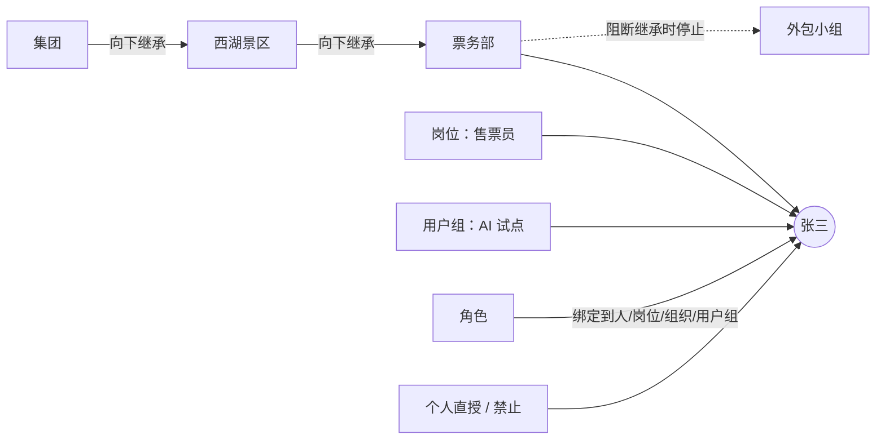

# PDS 统一权限 — 功能扩展规划（V2）

> 一期做出了"能用的授权内核"：单点登录、角色、人员明细权限、资源授权、景区隔离、审计。
> 但管理台偏简单：权限点只能由应用清单注册，组织不能直接挂权限，授权分散在三处，角色只在 PDS 内部生效。
> V2 的目标是把 PDS 做成**可运营的权限管理平台**：权限可在后台维护，组织即权限，所有授权一本账，角色可下发，权限关系可视化。
>
> 标记说明：★ 本次提出的需求　＋ 补充建议　（P0/P1/P2）优先级

---

## 1. 现状盘点

| 领域 | 一期现状 | 不足 |
|---|---|---|
| 权限点 | 应用通过清单注册，扁平列表，类型固定（MENU/FUNCTION/API/AI_TOOL…），主键是权限编码 | 后台不能新增、编辑；没有层级（应用→域→菜单→按钮）；类型不能扩展；没有版本 |
| 组织架构 | 组织树增删改、人员挂载、岗位、用户组 | 组织节点不能直接分配权限，只能绑定角色；没有"阻断继承"；加人、调岗前看不到权限变化 |
| 授权 | 角色绑定、人员明细、资源授权三张表三个入口 | 没有统一台账；没有批量授权、复制、模板、续期；改动前没有影响分析 |
| 角色 | 扁平角色 + 权限 + 绑定，三员内置 | 没有角色类型、继承、互斥；不能下发到其他系统；没有版本 |
| 可视化 | 单人"权限解释" | 看不到全局：谁能进哪个应用、某个高风险权限在谁手里 |
| 其他 | — | 没有申请审批、权限复核、身份源同步、数据权限策略、下发中心、分级管理员 |

## 2. 扩展后的功能地图

```
PDS 统一权限 V2
├── 工作台（增加：我的待办、风险提醒、下发异常）
├── 权限中心
│   ├── ★ 权限树 ............ 权限节点的统一维护（应用/域/菜单/按钮/接口/数据/字段/AI 能力…）
│   ├── ★ 系统角色 .......... 角色定义、继承、互斥、下发到各应用
│   ├── ★ 分配库 ............ 全部授权记录的总账与批量编辑
│   └── ★ 权限图谱 .......... 人—组织—角色—权限—应用的关系图与分析
├── 组织与人员
│   ├── ★ 架构树 ............ 组织增删改、节点权限、继承、添加人员
│   ├── 人员 / 岗位 / 用户组
│   └── ＋ 身份源与同步 ...... 飞书 / 钉钉 / 企业微信 / LDAP / HR 系统
├── ＋ 数据与策略
│   ├── 数据域 / 业务域 ...... 与 PDK 治理台的标注共用一套
│   ├── 行级 / 列级数据权限
│   ├── 脱敏策略
│   └── 密级
├── ＋ 申请与复核
│   ├── 权限申请 / 审批
│   ├── 权限复核任务
│   └── 风险中心（职责分离、沉睡权限、离职残留）
├── 应用中心
│   ├── 应用与客户端（已有，增加注册向导、应用管理员）
│   ├── ＋ 下发与集成中心 .... 订阅、投递日志、对账
│   └── ＋ 应用门户 .......... 登录后看到自己能进的系统
├── 审计与报表（已有审计，增加权限变更审计、报表导出）
└── 系统设置（＋ 字典、安全策略、分级管理员、通知渠道）
```

---

## 3. 先统一几个核心概念

V2 的五个模块共用同一套底座。先把底座讲清楚，后面各模块才不会各做各的。

### 3.1 权限节点：一棵树管所有权限

把一期的"权限点"升级为**权限节点**，所有应用的权限组成一棵树：

```
PDK 知识服务（应用）
├── 票务业务域（业务域）
│   ├── 票务知识库（菜单）
│   │   ├── 查看（按钮）            pdk:ticket:kb:view
│   │   ├── 上传文档（按钮）        pdk:ticket:kb:upload
│   │   └── 下载原文（按钮，高风险） pdk:ticket:kb:download
│   └── 检索接口（接口）            pdk:ticket:search
├── 交易数据域（数据域）
│   └── 订单明细（数据）
│       ├── 手机号（字段，秘密）
│       └── 身份证号（字段，机密）
└── AI 能力
    ├── 知识检索（工具）
    └── 通义千问 Max（模型）
```

- **节点类型可维护**（字典），内置：应用、业务域、数据域、模块、菜单、页面、按钮、接口、数据、字段、智能体、技能、工具、模型、资源类型。管理员可以新增类型。
- **ID 系统自动生成**（不可变，内部关联用）。**权限编码**给应用接入用：默认按"父节点编码 + 本节点标识"自动拼接，可修改，发布后锁定。
- 节点分两种：**分组节点**（只用于归类，如"AI 能力"）和**可授权节点**。业务域、数据域默认可授权，即"授予整个域"。

### 3.2 两条展开规则

| 规则 | 说明 |
|---|---|
| **授予父节点 = 授予其全部下级** | 包括以后新增的下级（动态包含）。**例外：高风险节点不随父节点授予**，必须单独授予，避免"给了整个域，结果新上线的下载功能也自动给了" |
| **授予子节点 ⇒ 祖先路径可见** | 授予"上传文档"按钮，自动让所在的菜单和应用"可见"，但不会带出兄弟按钮 |
| **禁止父节点 = 禁止全部下级** | 包括高风险节点 |

### 3.3 授权主体与继承链



人员的生效权限 = 以下来源的并集，再减去所有禁止：

1. 所在组织节点的**节点权限**，以及上级链上设为"向下继承"的节点权限（遇到"阻断继承"的节点停止）
2. 岗位权限
3. 用户组权限
4. 通过人员、岗位、组织、用户组绑定的**角色**（含角色继承来的权限）
5. 个人直授

### 3.4 生效规则（V2 完整版，按顺序判断）

1. 账号停用或离职 → 无任何权限
2. 未获得 `{app}:access` → 该应用全部权限无效
3. 收集 3.3 中的全部来源，过滤掉不在有效期内的
4. 按 3.2 展开权限树
5. **禁止优先**：任一来源禁止即拒绝
6. 约束：景区隔离、密级、停用节点无效、数据范围取并集

### 3.5 统一授权记录：分配库的底座

一期的三张授权表（`auth_role_binding`、`auth_user_perm`、`auth_resource_grant`）合并成一张**授权记录表** `auth_grant`。每条记录都是同一句话：

> **谁**（人员 / 组织 / 岗位 / 用户组）**被允许或禁止**使用 **什么**（权限节点 / 角色 / 资源实例 / 应用准入），**在什么范围**（数据范围、是否含下级组织），**到什么时候**（有效期），**为什么**（原因、来源：手工 / 申请单 / 模板 / 同步）。

分配库、架构树的"节点权限"、人员明细权限、权限图谱都读写这一张表。迁移时旧表数据整体搬入，旧接口保持兼容。

---

## 4. 模块明细

### 4.1 ★ 权限树（P0）

**页面布局**：左侧为应用列表加权限树（可搜索、按类型筛选），右侧为节点详情。详情页签：基本信息 / 下级节点 / 谁拥有 / 变更记录。

| 功能 | 说明 |
|---|---|
| 新增节点 | 选父节点 → 选类型（只列出该父节点允许的子类型）→ 填名称；ID 自动生成，编码自动拼接可改 |
| 编辑节点 | 名称、描述、风险等级、密级、排序、是否可授权、是否支持数据范围；**清单托管**的节点只能改显示和风险，编码、名称以应用清单为准 |
| 移动 / 排序 | 拖拽调整父节点和顺序；移动前提示"影响 N 条授权" |
| 停用 / 删除 | 停用后保留授权但不生效；删除前必须没有生效授权，否则引导去分配库处理 |
| 批量新增 | 粘贴或 Excel 导入一批按钮、接口 |
| 节点类型管理 | 新增或编辑类型：名称、图标、颜色、允许的父类型、是否可授权、是否支持数据范围、是否挂资源实例、默认风险 |
| 与应用清单同步 | 应用提交清单时生成**差异预览**（新增、变更、将停用），管理员确认后生效，也可设为自动生效；后台手工建的节点可**导出为清单**交给应用开发接入 |
| 发布与版本 | 编辑先进入草稿，发布后生成版本、可对比、可回滚；发布会触发下发（见 4.10） |
| 谁拥有 | 列出直接授权和通过角色、组织继承得到该节点的人数，可跳转分配库、图谱 |
| 风险标注 | 高风险、机密节点在树上醒目标识，授予时强制填写原因；可标"需二次验证"，使用时须再次验证身份（见 10.3） |

### 4.2 ★ 架构树（P0）

**页面布局**：左侧为组织树，右侧为节点详情。详情页签：基本信息 / 成员 / 岗位 / **节点权限** / **生效权限预览** / 节点管理员 / 变更记录。

| 功能 | 说明 |
|---|---|
| 新增 / 编辑节点 | 类型（集团、公司、景区、部门、小组、虚拟组织，可在字典里扩展）、编码自动生成、负责人、是否景区（隔离边界）、排序 |
| 移动 / 合并 | 拖拽移动到新上级；合并两个部门（人员、岗位、授权一起迁移）。两者都先预览权限变化 |
| 停用 / 删除 | 删除前须无成员、无下级；否则提供"批量迁移成员后删除"向导 |
| **节点权限** | 从权限树勾选权限（按应用、类型筛选，支持搜索），也可以挂角色。每条可设：允许/禁止、**继承方式**（本节点及下级 / 仅本节点）、数据范围、有效期 |
| **继承控制** | 节点开关"继承上级权限"，关闭即阻断，适用于外包、实习等需要隔离的部门；树上用图标标出阻断节点 |
| **添加人员** | 在节点上直接添加：从人员库选择、新建或批量导入；设置主属/兼职和岗位。保存前弹出**"将获得的权限"预览**（新增几项、其中高风险几项） |
| 调岗 / 移出 | 同样先预览权限增减；调岗可选"旧部门权限保留 N 天"作为交接期 |
| 兼职 | 兼职节点的权限默认继承，可逐人关闭；数据范围"本部门"按主属部门计算 |
| 生效权限预览 | 查看本节点成员会获得的完整权限，以及每项来自哪一级 |
| 节点管理员 | 指定该子树的管理员，只能在子树内管理人员、分配权限，且不能超出给他的可分配范围（见 4.12） |
| 同步标记 | 来自飞书、HR 的节点标"同步"，关键字段只读，避免手改后被下次同步覆盖 |

### 4.3 ★ 分配库（P0）

**定位**：全部授权记录的总账和批量编辑台。"给谁授权""收回什么"都在这里完成，架构树和人员页的授权操作也会写进这本账。

**三个视角**（顶部切换）：

| 视角 | 用法 |
|---|---|
| 按应用 | 选应用 → 看这个应用的准入名单、应用管理员，以及全部授权（主体 × 权限/角色），可切换列表或矩阵 |
| 按主体 | 选人员、组织、岗位或用户组 → 看他的全部直接授权和最终生效结果 |
| 按权限 | 选权限节点或角色 → 看谁拥有：直接授予的、经组织或角色继承的分开展示 |

| 功能 | 说明 |
|---|---|
| 新增授权 | 主体多选 × 对象多选（权限节点、角色、资源、应用准入）× 允许/禁止 × 数据范围 × 有效期 × 原因，一次批量生成 |
| 编辑 | 修改有效期、数据范围、原因；批量续期 |
| 撤销 | 单条或批量；高风险撤销需二次确认 |
| **影响分析** | 保存前显示："影响 32 人，新增 5 项高风险权限，与职责分离规则冲突 1 处" |
| 复制权限 | 把 A 的权限复制给 B（新人对标老员工），可勾选要复制的部分 |
| 交接 | 离职或调岗时，把 A 拥有的资源（知识库负责人等）转交给 B |
| 授权模板（权限包） | 如"新售票员入职包"；应用到人员或岗位时展开为授权记录，模板更新后可选择同步到已授予的人 |
| 导入 / 导出 | Excel 模板批量授权；按任意筛选条件导出授权清单 |
| 到期管理 | 即将到期列表、到期前提醒本人和负责人、一键续期 |
| 冲突检测 | 职责分离冲突、超出自身可授范围、同一对象同时允许和禁止，都会提示 |
| 变更历史 | 每条授权的创建、修改、撤销记录，可回滚到某一版本 |

### 4.4 ★ 系统角色（P0）

| 功能 | 说明 |
|---|---|
| 角色类型 | **内置角色**（三员，不可删）/ **全局角色**（跨应用）/ **应用角色**（归属某应用，可由应用清单声明，也可在 PDS 新建）/ **景区角色**（只在指定景区内生效） |
| 新增 / 编辑 / 复制 / 停用 / 删除 | 编码自动生成可改；删除前若有绑定，须先解绑或确认一并删除 |
| 角色内容 | 从权限树勾选权限、设数据范围；可挂资源实例 |
| 角色继承 | 子角色自动拥有父角色的权限，如"景区知识管理员"继承"PDK 普通用户"；最多 3 层，禁止成环 |
| 互斥与前置 | 互斥角色不能同时授予同一人（如"审计管理员"与"系统管理员"）；前置角色要求先拥有某角色 |
| 成员 | 绑定人员、岗位、组织（可含下级）、用户组；成员上限；角色负责人 |
| **外部编码映射** | 每个目标应用可配一个外部角色编码，如 PBI 的角色 ID、票付通的角色码，下发时按映射转换 |
| **下发** | 四种方式按应用选择：① 令牌声明（该应用令牌里带 `roles`）② 快照接口拉取 ③ 事件推送（Webhook 或消息队列）④ SCIM 2.0（第三方 SaaS） |
| 下发状态 | 每次角色变更在每个应用上的投递结果：成功、失败、重试中；可手动重推 |
| 对账 | 拉取应用侧的角色和成员，与 PDS 比对并列出差异 |
| 版本 | 每次保存生成版本，可对比、回滚 |

### 4.5 ★ 权限图谱（P0 基础版，P1 分析能力）

**节点**：人员、组织、岗位、用户组、角色、应用、权限节点、资源实例、景区。
**连线**：属于、担任、成员、绑定、包含、授予、禁止、继承、归属。

| 视图 | 回答的问题 |
|---|---|
| 以人为中心 | 张三能做什么？每项权限从哪条路径来？ |
| 以应用为中心 | 谁能进 PDK？通过哪些组织、角色？ |
| 以权限为中心 | "下载原文"这个高风险权限在谁手里？ |
| 以组织为中心 | 西湖景区各部门的权限分布 |
| 全局总览 | 应用 × 组织的聚合关系图（按聚合展示，不直接画出全部人员） |

| 功能 | 说明 |
|---|---|
| 展开 / 收起 | 点节点展开邻居，逐步探索；单屏最多 500 个节点，超出自动聚合 |
| 路径高亮 | 选人和权限，高亮"为什么有"的全部路径；禁止路径标红 |
| 筛选 | 景区、应用、风险等级、有效期、来源类型 |
| 权限模拟 | 假设把张三调到财务部或给他加某个角色，图上直接显示权限增减（P1） |
| 风险分析 | 高风险权限持有者、超过 90 天未使用的权限（依据鉴权调用日志）、离职仍有授权、无成员角色、无人使用的权限、职责分离冲突（P1） |
| 角色挖掘 | 找出权限高度相似的人群，建议提炼为角色（P2） |
| 时间回溯 | 查看某个日期的图谱，配合审计追溯（P2） |
| 导出 | 图片、CSV（节点和关系清单） |

技术选型：前端 AntV G6（支持大图、力导向和层次布局），后端从关系库按需计算并缓存。规模超过约 10 万条关系后，再考虑引入图数据库。

### 4.6 ＋ 数据与策略（P1）

与 PDK 治理台的"数据域 / 业务域"标注共用同一套分类，PDK、PDQ、PBI、PDD 按同一策略执行。

| 功能 | 说明 |
|---|---|
| 数据域 / 业务域 | 维护分类树，与权限树中的域节点联动 |
| 列级权限 | 字段可见、脱敏、禁止，按人员密级和授权判断 |
| 行级权限 | 规则表达式，如 `景区 = 本人景区范围 AND 渠道 IN (...)`，通过快照下发 |
| 脱敏策略库 | 手机号、身份证、姓名、银行卡、自定义正则；按密级套用；提供"查看原文"申请 |
| 密级 | 人员密级与数据密级（公开 / 内部 / 秘密 / 机密） |

### 4.7 ＋ 权限申请与审批（P1）

| 功能 | 说明 |
|---|---|
| 自助申请 | 在应用门户或任一系统的"无权限"页点"申请此权限"（带深链），选有效期、填原因 |
| 审批流 | 直属上级 → 权限负责人 → 安全管理员（高风险才走这一步）；可对接飞书审批 |
| 权限负责人 | 每个应用、权限节点、资源可指定负责人，负责审批 |
| 临时授权 | 审批通过后自动写入分配库，到期自动收回 |
| 我的申请 / 待我审批 | 列表、催办、撤回 |

### 4.8 ＋ 权限复核与风险中心（P1）

| 功能 | 说明 |
|---|---|
| 复核任务 | 按季度或按应用发起，部门负责人逐人确认下属权限；逾期未确认可按配置自动回收 |
| 职责分离规则库 | 定义互斥权限或角色组合；授权时拦截，并对存量做扫描 |
| 风险扫描 | 沉睡权限、离职或调岗残留、过度授权、长期有效的高风险授权 |
| 告警 | 高风险授权、批量授权、非工作时间的管理操作、越权拦截激增；推送到飞书或邮件 |

### 4.9 ＋ 身份源与账号生命周期（P1）

| 功能 | 说明 |
|---|---|
| 身份源 | 飞书、钉钉、企业微信、LDAP/AD、HR 系统；字段映射；定时同步加事件同步 |
| 入职 | 自动建号，按岗位或授权模板授予初始权限，发送初始密码或扫码激活 |
| 调岗 | 按 4.2 的规则处理，旧权限保留交接期 |
| 离职 | 立即停用、吊销令牌、资源交接 |
| 账号安全 | 二次认证（MFA）、密码策略、登录限制（IP、时段）、在线会话查看与强制下线 |

### 4.10 ＋ 下发与集成中心（P0 Webhook，P1 消息队列与 SCIM）

| 功能 | 说明 |
|---|---|
| 订阅管理 | 每个应用订阅关心的事件：权限树发布、角色变更、角色成员变更、组织变更、人员变更、授权变更 |
| **单点注销** | 用户注销、被停用或被踢下线时，按 OIDC 后端通道注销规范通知所有已登录的应用（P0） |
| 投递方式 | Webhook（HMAC-SHA256 签名加时间戳防重放、可重试）、消息队列、SCIM 2.0 |
| 投递日志 | 每条事件在每个应用上的状态、耗时、失败原因；手动重推 |
| 对账 | 定时比对应用侧数据，列出差异 |
| SDK | Java 端基于 Sa-Token 做接入适配（见第 10 章），Python SDK 供 PDA、PDK 使用：令牌校验、快照缓存、事件订阅 |

事件格式示例：

```json
{
  "id": "evt_01J…",
  "type": "role.members.changed",
  "app": "pbi",
  "occurredAt": "2026-11-08T10:00:00+08:00",
  "authzVersion": 1289,
  "data": {
    "roleCode": "PBI_SCENIC_VIEWER",
    "externalCode": "pbi_role_17",
    "added": [{"uid": "u_001", "empNo": "S001023"}],
    "removed": []
  }
}
```

### 4.11 应用中心增强（P1）

- 应用注册向导：分类 → 准入 → 回调地址 → 客户端 → 清单 → 下发方式，一步步完成
- 应用负责人、应用管理员：可在本应用范围内授权
- **应用门户**：用户登录 PDS 后看到自己能进入的系统，点一下即单点登录进入

### 4.12 ＋ 分级管理（P1）

- 管理范围 = 组织子树 + 应用 + 可分配权限池
- 分级管理员只能把自己被允许分配的权限授给自己范围内的人，**不能超授**
- 保留三员分立：系统管理员、安全管理员、审计管理员

### 4.13 审计与报表增强（P1）

- 权限变更审计记录变更前后的差异（哪条授权、谁改的、改了什么）
- 报表：人员权限清单、应用授权清单、高风险权限报表、复核报告、到期报表，可导出 Excel/PDF
- 等保合规报表（P2）

### 4.14 系统设置（P1）

- 字典：权限节点类型、组织类型、人员类型、密级、景区
- 安全策略：密码、会话、登录限制
- 通知渠道：飞书、邮件、短信
- 登录页、品牌配置

---

## 5. 管理后台菜单调整

现在的侧栏是 6 个图标。V2 按"一级分组图标 + 二级浮出菜单"组织：

| 一级 | 二级 |
|---|---|
| 工作台 | — |
| 权限中心 | 权限树、系统角色、分配库、权限图谱 |
| 组织与人员 | 架构树、人员、岗位、用户组、身份源 |
| 数据与策略 | 数据域/业务域、数据权限、脱敏策略、密级 |
| 申请与复核 | 我的申请、待我审批、复核任务、风险中心 |
| 应用中心 | 应用、下发中心、应用门户 |
| 审计与报表 | 审计日志、权限变更、报表 |
| 系统设置 | 字典、安全策略、分级管理员、通知 |

---

## 6. 数据模型变更（概要）

| 表 | 变更 | 说明 |
|---|---|---|
| `perm_node` | 新建，替代 `perm_point` | `id`（自动生成）、`app_code`、`parent_id`、`path`、`type_code`、`code`、`name`、`risk`、`security_level`、`grantable`、`source`（MANIFEST/MANUAL）、`status`、`sort`、`attrs` |
| `perm_node_type` | 新建 | 节点类型字典：允许的父类型、是否可授权、是否支持数据范围、是否挂资源、默认风险 |
| `perm_tree_version` | 新建 | 权限树发布版本快照 |
| `org_unit` | 加字段 | `inherit_from_parent`（阻断继承）、`source`、`external_id` |
| `sys_user_org` | 加字段 | `inherit_perms`（兼职是否继承） |
| `auth_grant` | 新建，合并三张授权表 | 主体、对象类型（PERM/ROLE/RESOURCE/APP_ACCESS）、对象、动作、效果、继承方式、数据范围、有效期、原因、来源、申请单号 |
| `auth_grant_history` | 新建 | 授权变更历史 |
| `grant_template`、`grant_template_item` | 新建 | 授权模板 |
| `auth_role` | 加字段 | `type`、`app_code`、`parent_role_id`、`status`、`max_members`、`owner_id`、`version` |
| `auth_role_mutex`、`auth_role_mapping`、`auth_role_version` | 新建 | 互斥、外部编码映射、版本 |
| `dist_subscription`、`dist_event`、`dist_delivery` | 新建 | 下发订阅、事件、投递 |
| `apply_ticket`、`approval_*` | 新建（P1） | 申请与审批 |
| `review_campaign`、`review_item`、`sod_rule` | 新建（P1） | 复核、职责分离 |
| `data_domain`、`mask_policy`、`row_policy` | 新建（P1） | 数据与策略 |
| `identity_source`、`sync_job` | 新建（P1） | 身份源 |
| `admin_scope` | 新建（P1） | 分级管理 |

授权引擎 `pds-authz-engine` 需要扩展：权限树展开（父含子、高风险例外、祖先可见）、组织节点权限沿继承链收集与阻断、角色继承、互斥校验。快照接口和令牌声明格式保持兼容，新增 `roles` 声明。

## 7. 新增接口（概要）

| 分类 | 接口 |
|---|---|
| 权限树 | `GET /perm-tree?app=`、`POST/PUT/DELETE /perm-nodes`、`POST /perm-nodes/{id}/move`、`GET/POST /perm-node-types`、`POST /perm-tree/{app}/publish`、`GET /perm-tree/{app}/versions`、`GET /apps/{app}/manifest/diff` |
| 架构树 | `GET/POST/DELETE /orgs/{id}/grants`、`PUT /orgs/{id}/inherit`、`POST /orgs/{id}/members`、`POST /orgs/{id}/move`、`POST /orgs/merge`、`POST /orgs/{id}/impact-preview` |
| 分配库 | `GET /grants`（主体、对象、应用、来源、有效期等筛选）、`POST /grants/batch`、`PUT /grants/{id}`、`POST /grants/revoke`、`POST /grants/impact`、`POST /grants/copy`、`POST /grants/handover`、`GET/POST /grant-templates`、`POST /grants/import`、`GET /grants/export` |
| 系统角色 | `POST /roles/{id}/copy`、`PUT /roles/{id}/parent`、`GET/POST /roles/{id}/mutex`、`GET/PUT /roles/{id}/mappings`、`GET /roles/{id}/versions`、`GET /roles/{id}/distribution` |
| 图谱 | `GET /graph/subject/{type}/{id}`、`GET /graph/app/{app}`、`GET /graph/perm/{nodeId}`、`GET /graph/overview`、`GET /graph/path?user=&perm=`、`POST /graph/simulate` |
| 下发 | `GET/POST /dist/subscriptions`、`GET /dist/deliveries`、`POST /dist/deliveries/{id}/retry`、`POST /dist/reconcile/{app}` |

## 8. 分期建议

| 期 | 范围 | 交付结果 |
|---|---|---|
| **P0** | 权限树、架构树（节点权限、继承、阻断、加人预览）、统一授权记录与分配库、系统角色（类型、继承、互斥、外部编码）、角色下发（令牌声明、快照、Webhook、投递日志）、单点注销、权限图谱基础版、菜单调整 | 本次提出的 5 个模块全部可用 |
| **P1** | 申请审批、复核与风险中心（含能力封禁）、身份源同步（飞书优先）与账号关联、数据与策略（数据域/业务域、列级、脱敏）、分级管理、会话中心、二次验证、API Key、消息队列与 SCIM 下发、图谱权限模拟与风险分析、报表、基于 Sa-Token 的 Java 接入 SDK 与 Python SDK | 可运营、可合规 |
| **P2** | 行级规则引擎、角色挖掘、图谱时间回溯、等保报表 | 智能化与合规深化 |

建议 P0 先用 UX Pilot 画出 5 个核心页面（权限树、架构树节点详情、分配库、系统角色、权限图谱），确认后再开发，保证界面与设计稿一致。

## 9. 需要确认的问题

| # | 问题 | 建议 |
|---|---|---|
| 1 | 授予父节点时，是否自动包含以后新增的子节点？ | 包含，高风险节点除外 |
| 2 | 组织节点权限是否默认向下继承？ | 默认继承，节点可阻断 |
| 3 | 兼职部门的权限是否继承？ | 继承，可逐人关闭；数据范围按主属部门 |
| 4 | 票付通、PBI 等系统有没有自己的角色体系需要映射？还是统一用 PDS 权限点？ | 两种都支持；已有角色体系的系统走外部编码映射 |
| 5 | 组织和人员数据来源是飞书、钉钉、企业微信还是 HR 系统？ | 决定 P1 身份源先接哪一个 |
| 6 | 审批是否走飞书审批？ | 若已在用飞书，建议直接对接 |
| 7 | 人员和应用规模（人数、应用数、权限节点数）？ | 决定图谱是否需要图数据库 |
| 8 | 个人"允许"能否覆盖组织"禁止"？ | 保持禁止优先；需要例外时对该节点阻断继承或撤销禁止 |
| 9 | 各业务系统的 Java 技术栈版本（Spring Boot 2/3/4、是否有网关）？ | 决定 Sa-Token 接入 SDK 先支持哪些版本（见第 10 章） |
| 10 | 畅游等 APP 的 C 端游客账号是否纳入 PDS？ | 建议不纳入，PDS 只管内部员工、外包和合作伙伴 |

---

## 10. 借鉴 Sa-Token

[Sa-Token](https://github.com/dromara/Sa-Token)（dromara，Apache-2.0，当前 1.46.0，已支持 Spring Boot 4）是国内使用最广的 Java 权限认证框架。它的定位是**嵌在单个应用（或网关）里**的认证鉴权库：登录会话、注解鉴权、踢人封禁、SSO、OAuth2。权限数据由应用自己实现 `StpInterface` 提供。

PDS 的定位是**中心化的身份与授权平台**：组织继承、禁止优先、景区隔离、统一授权台账，供几十个系统共用。两者是上下游关系，不是二选一。

### 10.1 结论

| 方向 | 建议 | 原因 |
|---|---|---|
| 用 Sa-Token 替换 PDS 认证中心 | **不替换** | PDS 基于 Spring Authorization Server，提供标准 OIDC。PDA（hermes-agent，Python）、PDK、BI 和第三方系统都能用标准库直接对接。Sa-Token SSO 是自有 ticket 协议，接入方需引入它的客户端或按其私有接口对接；其 OAuth2/OIDC 模块也更偏轻量 |
| **把 Sa-Token 作为 PDS 的 Java 接入 SDK** | **采用（P1）** | 各 Java 系统接入 PDS 后直接用 `@SaCheckPermission("pdd:dataset:export")`、路由拦截、网关鉴权。它覆盖 Spring Boot 2/3/4、WebFlux、Solon、JFinal，比我们为每个框架版本各写一个 Starter 省力得多；票付通等老系统若还在 Spring Boot 2 也能接 |
| 借鉴功能设计 | **采用**，见 10.3 | 二级认证、分类封禁、单点注销、会话管理等，PDS 目前缺 |

### 10.2 SDK 方案：`pds-sa-token-adapter`

```
应用（Spring Boot 2/3/4、Gateway）
 ├─ sa-token-spring-boot*-starter
 └─ pds-sa-token-adapter
     ├─ 校验 PDS 签发的 JWT（JWKS 验签、iss/aud/exp）→ 建立 Sa-Token 登录态
     ├─ StpInterface 实现：getPermissionList / getRoleList ← PDS 权限快照
     │    本地缓存；令牌里的 authz_ver 变大或收到变更事件时刷新；PDS 不可用时只读降级，不默认放行
     ├─ 订阅 PDS 下发事件：权限变更刷新缓存；单点注销、停用时踢下线
     └─ 审计上报：鉴权拒绝、敏感操作自动上报 /api/v1/audit/events
```

应用侧写法：

```java
@SaCheckPermission("pdd:dataset:export")          // 功能权限
@SaCheckRole("PBI_SCENIC_VIEWER")                  // PDS 下发的角色（按外部编码映射）
@SaCheckSafe("download")                           // 二级认证（见 10.3）
public Result export(...) { ... }
```

数据范围、资源实例过滤、景区隔离不在 Sa-Token 的模型里，由 adapter 额外提供 `PdsAuthz.dataScope(...)`、`PdsAuthz.accessibleResources(...)`。

### 10.3 借鉴到 PDS 的功能

| Sa-Token 能力 | PDS 中的落地 | 放到哪个模块 | 优先级 |
|---|---|---|---|
| **二级认证**（`openSafe`：已登录后对敏感操作再验一次） | 权限树节点增加"需二次验证"属性：下载原文、查看脱敏原文、批量授权、删除组织等。PDS 提供二次验证（密码 / 短信 / 飞书扫码），令牌带 `acr`、`auth_time`，验证结果在设定时间窗口内有效 | 权限树、账号安全 | P0 属性，P1 验证方式 |
| **分类封禁 + 阶梯封禁**（只禁某项能力，按等级处罚） | **能力封禁**：临时禁用某人的某个能力，如因滥用禁用 PDA 智能问答 1 天，按次数升级处罚。应用可通过接口申请封禁，如 PDA 检测到提示词攻击。生效方式是带原因和等级的限时"禁止"授权，在分配库和图谱中可见 | 风险中心、分配库 | P1 |
| **单点注销**（一处注销，全端下线） | PDS 目前只结束自己的会话。补 OIDC 后端通道注销（Back-Channel Logout）和前端通道注销：用户注销、被停用、被踢时通知所有已登录的应用 | 下发与集成中心 | **P0** |
| **踢人下线 / 同端互斥登录 / 会话查询** | **会话中心**：按人、按终端（PC / APP / 小程序）查看在线会话，可按终端踢下线；每个应用可配"同端互斥"和最大并发会话数 | 账号安全 | P1 |
| **模拟他人**（以指定账号判断权限） | "以他人视角预览"：只读预览某人看到的菜单和权限，全程审计；不提供真实代登录 | 权限图谱 | P1 |
| **权限码通配符**（`pdk:*`、`pdk:doc:*`） | 授予父节点在效果上等同于通配符（3.2）。快照接口可按通配符压缩返回，减小体积，adapter 的 Sa-Token 通配符匹配可直接使用 | 权限树、开放接口 | P0 |
| **API Key**（带权限范围、可过期吊销的调用秘钥） | 个人或应用的 API Key：用于脚本调用 PDK 检索、PDA 插件等程序化访问，绑定权限节点，可设有效期、随时吊销，调用写审计 | 应用中心、个人设置 | P1 |
| **平台中心跳转模式** | 应用门户：登录后列出有权限的系统，点击直接进入（4.11） | 应用中心 | P1 |
| **用户数据同步三方案**（统一迁移 / 实时同步 / 字段关联） | 已有独立账号体系的系统接入时，提供**账号关联**：PDS 人员 ↔ 应用本地账号映射表；支持按工号、手机号批量匹配，或由事件实时同步 | 身份源与账号生命周期 | P1 |
| **多账号体系**（管理员 / 用户分开的会话体系） | 账号域：员工、外包、合作伙伴分域管理，策略不同（密码、二次验证、有效期）。C 端游客账号不纳入 PDS（待确认） | 人员、系统设置 | P2 |
| **API 参数签名 / 内部服务令牌** | 下发 Webhook 与回调使用 HMAC-SHA256 签名加时间戳和随机串防重放（Sa-Token 默认用 md5，PDS 不采用）；服务间调用继续用客户端凭证 JWT | 下发与集成中心 | P0 |

**不借鉴的**：Sa-Token SSO 私有协议（继续用标准 OIDC）、匿名客户端接入（安全性不够）、md5 签名、把权限存在会话里（PDS 用快照 + 版本号失效）。

---

## 11. P0 实现状态（2026-11）

界面按 UX Pilot 设计稿（PD 平台 UI · PDS V2 权限中心）实现，后端、前端与测试已提交。

| 模块 | 已实现 | 暂未实现（原因） |
|---|---|---|
| 权限树 | 树形节点、节点 ID 自动生成、编码按父节点拼接（草稿可改、发布后锁定）；节点类型为可维护字典，没有不可删除的内置类型（在用的类型不能删）；新增、修改、移动、停用、删除进入草稿，查看差异后按应用发布（vYYYY.M.n）；谁拥有、变更记录、发布记录、导出为权限清单；后台新增应用；风险、密级、需二次验证、可授权、支持数据范围 | 拖拽排序（用"移动"代替）；二次验证的实际校验（属性已可设置，验证流程 P1） |
| 授权引擎 | 授予父节点 = 全部非高风险下级；禁止父节点 = 全部下级；上级路径可见；人员/组织/岗位/用户组均可直接授予或禁止权限节点；组织阻断继承；兼职可关闭继承；草稿与停用节点（含下级）不生效；角色继承（最多 3 层）；停用角色不生效 | — |
| 架构树 | 节点详情（成员、岗位、节点权限含上级继承来源、生效权限预览、变更记录）；继承开关；从权限树添加权限、挂载角色；添加人员（主属/兼职、岗位）前预览新增/高风险/失去的权限；拖拽移动组织 | 节点管理员（属分级管理，P1） |
| 分配库 | 权限节点授权、角色绑定、资源授权、人员资源明细统一视图；按应用/按主体（可含经组织岗位用户组的记录）/按权限（含经上级节点与角色）查看；筛选、导出、复制权限、续期、修改有效期、撤销；批量授权（全部成功或回滚）与实时影响分析 | 授权模板、Excel 导入（P1）；记录在内存汇总，数万条以上需改为数据库视图分页 |
| 系统角色 | 内置/全局/应用/景区类型；编码自动生成；父角色继承链、互斥（授予时校验，含经组织、岗位覆盖的人员）、外部编码映射、版本与回滚、成员、复制、启停、删除 | — |
| 下发 | 令牌 `roles` 声明、快照 `roles`、Webhook（HMAC-SHA256 签名、退避重试、投递记录、查看载荷、重推）、立即对账（推送全量成员）；权限树发布与角色变更自动下发 | 消息队列、SCIM（P1）；"对账"为推送全量清单由应用侧校正，PDS 不拉取应用侧数据 |
| 权限图谱 | 以人/应用/权限/组织为中心与全局总览；路径高亮与解释；未使用提醒（依据审计中的使用记录）；权限模拟；缩放、平移、拖动节点、小地图、导出 SVG/CSV | 景区、来源筛选与时间回溯（P2）；角色挖掘（P2） |
| 菜单 | 一级图标 + 悬停浮出二级菜单；未实现的模块（数据与策略、申请与复核）不显示 | — |

单点注销（OIDC 后端通道注销）原列为 P0，本次未包含，排在下一批。
