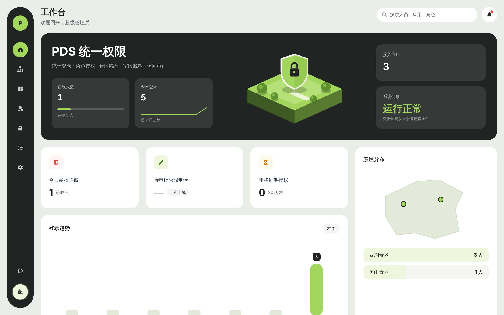

# pds-web — PDS 统一权限管理后台

独立的前端工程，**可单独部署，也可编译后随 PDS 一起发布**。两种方式使用同一份代码，环境差异全部通过**运行时配置**（`config.js`）解决，不需要为每个环境重新构建。



## 技术栈

| 用途 | 选型 |
|---|---|
| 框架 | Vue 3 + TypeScript + Vite + Vue Router + Pinia |
| 组件库 | [View UI Plus](https://www.iviewui.com/view-ui-plus)（iView 的 Vue 3 版本，API 与 iView 4 一致；iView 4 本身只支持 Vue 2）|
| 图标 | [Semi Design 图标](https://semi.design/zh-CN/basic/icon) 的 Vue 3 版本 `@kousum/semi-icons-vue` |
| 动效组件 | [Inspira UI](https://inspira-ui.com)：NumberTicker、BorderBeam、FlickeringGrid、CardSpotlight（源码复制于 `src/components/inspira/`，MIT） |
| 样式 | Tailwind CSS 4（不启用 preflight）+ View UI Plus Less 主题（PDS 品牌色 `#1E50E6` / `#22E59A`） |
| 图表 | ECharts（vue-echarts） |
| 登录 | OIDC 授权码 + PKCE（公共客户端 `pds-console`，无密钥），令牌仅存于 sessionStorage |
| 包管理 | **pnpm 10**（版本固定在 `package.json` 的 `packageManager`，锁文件 `pnpm-lock.yaml`）；Node.js 20+ |

> View UI Plus 的样式整体放在最低优先级的级联层 `viewui` 中，避免其全局重置覆盖 Tailwind 工具类。

## 页面

工作台 · 组织架构 · 人员管理 · 用户组 · 角色管理 · 人员明细权限 · 资源授权 · 应用管理 · 审计中心 · 个人中心。菜单与路由按当前人员在 PDS 中的权限点（`pds:*`）显示。

## 配置

### 构建期（只有访问路径）

| 变量 | 默认 | 说明 |
|---|---|---|
| `VITE_BASE` | `/` | 页面访问路径。单独部署通常为 `/`；随 PDS 发布为 `/console/`（`.env.pds`） |
| `PDS_WEB_OUT_DIR` | `dist` | 构建输出目录 |
| `PDS_DEV_TARGET` | `http://127.0.0.1:9000` | 开发服务器代理的 PDS 地址 |

### 运行时（`config.js`）

```js
window.__PDS_CONFIG__ = {
  title: 'PDS 统一权限',            // 页面标题
  issuer: 'https://pds.example.com', // PDS 认证中心地址（浏览器跳转登录）
  apiBaseUrl: '',                    // 接口地址；为空表示与页面同源（随 PDS 发布或经反向代理）
  clientId: 'pds-console',           // 管理后台在 PDS 中的客户端
}
```

## 部署方式一：随 PDS 一起发布

```bash
cd pd_centralized_permission
mvn -Pweb package
```

- `-Pweb` 会在 `pds-web` 下执行 `pnpm install --frozen-lockfile` 与 `pnpm run build:pds`，编译产物输出到 `pds-server/target/classes/static/console/`，随后打入 jar 的 `BOOT-INF/classes/static/console/`，访问 `{PDS 地址}/console/`。
- 打包机需安装 Node.js 20+ 与 pnpm 10+（`corepack enable` 即可按 `packageManager` 自动使用固定版本）；Windows 下自动改用 `pnpm.cmd`。
- 编译产物位于 `target/` 下，不提交到 Git；`mvn clean -Pweb package` 会重新编译前端。
- `config.js` 由 PDS 按自身配置动态生成（`pds.issuer`、`pds.console.*`），无需另外维护。
- PDS 启动时自动登记/同步客户端 `pds-console`，默认回调地址为 `{pds.issuer}/console/auth/callback`。

## 部署方式二：单独部署

### Docker（推荐）

```bash
docker build -t pds-web .
```

```bash
docker run -d -p 8080:80 \
  -e PDS_ISSUER=https://pds.example.com \
  -e PDS_UPSTREAM=http://pds-server:9000 \
  pds-web
```

| 环境变量 | 必填 | 说明 |
|---|---|---|
| `PDS_ISSUER` | 是 | PDS 认证中心对外地址 |
| `PDS_UPSTREAM` | 否 | 设置后由容器内 Nginx 反向代理 `/api` 与 `/oauth2/token` 到 PDS（同源，无需跨域） |
| `PDS_API_BASE_URL` | 否 | 不使用反向代理时浏览器直连的 PDS 接口地址，默认等于 `PDS_ISSUER` |
| `PDS_CLIENT_ID` | 否 | 默认 `pds-console` |
| `PDS_TITLE` | 否 | 页面标题 |

容器启动脚本 `deploy/40-pds-runtime.sh` 按上述变量生成 `config.js` 与 Nginx 配置（前端路由回退、静态资源缓存、可选反向代理）。

### 其他静态服务器

```bash
pnpm install --frozen-lockfile && pnpm build
```

将 `dist/` 部署到任意静态服务器，编辑 `dist/config.js`，并配置前端路由回退到 `index.html`。

### PDS 侧需要的配置

| 配置项 | 说明 |
|---|---|
| `pds.console.redirect-uris` | 加入前端回调地址，如 `https://pds-admin.example.com/auth/callback` |
| `pds.console.post-logout-redirect-uris` | 加入退出后跳转地址，如 `https://pds-admin.example.com/` |
| `pds.cors.allowed-origins` | 仅在**不经反向代理**、浏览器直连 PDS 时需要，填前端来源，如 `https://pds-admin.example.com` |

对应环境变量：`PDS_CONSOLE_REDIRECT_URIS`、`PDS_CONSOLE_POST_LOGOUT_URIS`、`PDS_CORS_ALLOWED_ORIGINS`（多个用逗号分隔）。

## 本地开发

```bash
# 终端 1：启动 PDS（内存数据库）
cd pd_centralized_permission && mvn -DskipTests package && java -jar pds-server/target/pds-server-0.1.0-SNAPSHOT.jar --spring.profiles.active=local
```

```bash
# 终端 2：启动前端
cd pd_centralized_permission/pds-web && corepack enable && pnpm install && pnpm dev
```

访问 <http://127.0.0.1:5173/>（必须用 `127.0.0.1`，OAuth 2.1 不允许 `localhost` 作为回调主机），账号 `admin` / `Pds@Admin2026`。

| 命令 | 说明 |
|---|---|
| `pnpm dev` | 开发服务器（代理 `/api`、`/oauth2/token` 到本地 PDS） |
| `pnpm build` | 单独部署构建（`dist/`） |
| `pnpm build:pds` | 随 PDS 发布构建（输出到 `pds-server/target/classes/static/console`） |
| `pnpm typecheck` | 类型检查 |

> 依赖的安装脚本默认不执行（pnpm 10 安全策略）；`pnpm-workspace.yaml` 中声明了无需执行的 `@parcel/watcher`。新增需要安装脚本的依赖时，用 `pnpm approve-builds` 审核后再提交。
